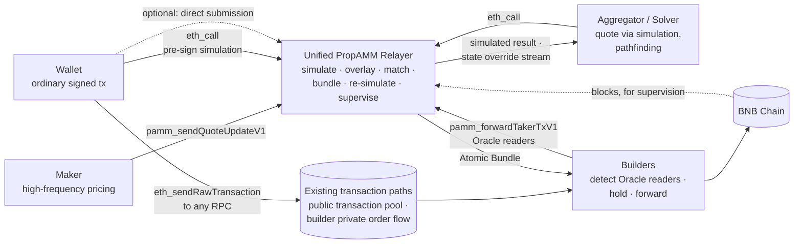
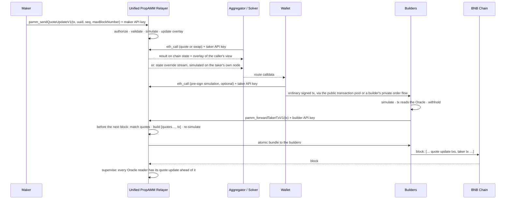

```
BAP: 710
Title: Unified PropAMM Relayer
Status: Draft
Type: Application
Created: 2026-09-03
Description: A builder-neutral execution layer for proprietary AMMs (PropAMMs) on BNB Chain, with a unified on-chain PropAMM standard. Makers stream quotes to one Relayer; takers send ordinary transactions through the path they already use, the public transaction pool or a builder's private order flow; builders forward every transaction that reads the PropAMM Oracle to the Relayer, which bundles it behind the matched quote updates and supervises every block.
```

# BAP-710: Unified PropAMM Relayer

- [BAP-710: Unified PropAMM Relayer]
  - [1. Summary](#1-summary)
  - [2. Abstract](#2-abstract)
  - [3. Motivation](#3-motivation)
    - [3.1 PropAMM Needs a Shared Execution Layer](#31-propamm-needs-a-shared-execution-layer)
    - [3.2 Who Carries the Complexity Today](#32-who-carries-the-complexity-today)
    - [3.3 Why One Oracle and One Pool Interface](#33-why-one-oracle-and-one-pool-interface)
  - [4. Specification](#4-specification)
    - [4.1 Roles and Architecture](#41-roles-and-architecture)
    - [4.2 PropAMM Oracle: Priority Update Registry](#42-propamm-oracle-priority-update-registry)
    - [4.3 PropAMM Pool Interface](#43-propamm-pool-interface)
    - [4.4 Relayer Endpoint and Authentication](#44-relayer-endpoint-and-authentication)
    - [4.5 Taker Integration](#45-taker-integration)
    - [4.6 Maker API](#46-maker-api)
    - [4.7 Builder Protocol](#47-builder-protocol)
    - [4.8 Maker Protection](#48-maker-protection)
    - [4.9 Supervision and Monitoring](#49-supervision-and-monitoring)
    - [4.10 Open Protocol Scope](#410-open-protocol-scope)
  - [5. Rationale](#5-rationale)
    - [5.1 Design Decisions](#51-design-decisions)
    - [5.2 Alternative Approaches Considered](#52-alternative-approaches-considered)
    - [5.3 Comparison with Existing PropAMM Deployments](#53-comparison-with-existing-propamm-deployments)
  - [6. Backwards Compatibility](#6-backwards-compatibility)
  - [7. Test Cases](#7-test-cases)
  - [8. Security Considerations](#8-security-considerations)
  - [9. Service Positioning and Fees](#9-service-positioning-and-fees)
  - [10. License](#10-license)

## 1. Summary

This BNB Chain Application Proposal (BAP) introduces the **Unified PropAMM Relayer**, a builder-neutral professional liquidity execution layer for BNB Chain, together with the unified on-chain **PropAMM Standard** it executes against and the **Builder Protocol** that connects it to ordinary transaction flow. Makers update quotes at high frequency through a single Relayer API. Takers read through the Relayer, with a standard `eth_call` or by subscribing to its state override stream, and submit ordinary transactions through the path they already use, which reaches builders either through the public transaction pool or through a builder's private order flow: the Relayer is needed for reading, not for submitting. A builder that finds, while building a block, a transaction that reads the PropAMM Oracle does not include it directly: it forwards the transaction to the Relayer. The Relayer matches the transaction with the quotes it depends on, builds an atomic bundle `[quote update txs…, taker tx]` and broadcasts it to the builders. The Relayer also supervises every block: a transaction that reads the Oracle may land only behind the quote update it reads.

> **Maker sends quotes. Taker reads through the Relayer and submits ordinary transactions anywhere. Builder forwards Oracle readers. Relayer builds bundles and supervises blocks.**

## 2. Abstract

A proprietary AMM (PropAMM) is a market-maker-operated pool whose pricing is driven by off-chain quotes rather than by an on-chain curve alone. PropAMMs deliver tighter spreads and better fills than passive AMMs, but every existing deployment pushes the execution complexity onto one participant: makers on Solana run chain-specific landing infrastructure, makers on Base pay to publish every quote update on-chain, and takers on Titan consume a builder-specific state override stream and construct bundles themselves.

BAP-710 defines three layers for BNB Chain:

- **PropAMM Standard (on-chain)**: a **Priority Update Registry** (the PropAMM Oracle) and an **IPropAMM Pool Interface**. The registry holds maker-published pricing state in fixed-layout, per-target lanes with a strictly increasing per-lane sequence number; updates are written directly by authorized updaters, or relayed by anyone as maker-signed (ECDSA or ERC-1271) payloads. The registry enforces no expiry: the Relayer and builders drop an update once its deadline passes, and a pool can check freshness when it reads its lane. The pool interface exposes `isActive`, `getPairs`, `quote` and `swap` to every taker in one consistent way.
- **Unified PropAMM Relayer (off-chain, builder-neutral)**: a Geth-compatible RPC endpoint and the single place where quotes and taker transactions are matched. It simulates each caller's requests on chain state plus the valid maker quotes that caller is authorized to see, receives taker transactions (forwarded by builders, or submitted directly), identifies the quotes each one depends on, assembles `[quote update txs…, taker tx]` into an atomic bundle, re-simulates it and fans it out to builders. It then checks every produced block against the quote-first rule.
- **Builder Protocol**: one rule added to block construction. A builder simulates every candidate transaction, as it already does; a transaction that reads the Oracle is withheld from the block and forwarded to the Relayer, and is included only as part of the bundle the Relayer returns. Builders hold no quotes, run no matching and need no PropAMM pricing logic.

Key properties:

- **No submission change**: a taker transaction is an ordinary transaction. It reaches builders the way it does today, through the public transaction pool or through a builder's private order flow. Wallets keep their RPC endpoint and their transaction model for submission.
- **Reads through the Relayer**: quotes stay off-chain until they fill, so pricing and simulation need the Relayer: a standard `eth_call` to it, or its state override stream applied on the taker's own node.
- **Relayer matching**: the Relayer stays the only component that matches quotes with transactions and builds bundles; unmatched quotes never leave it.
- **Just-in-time execution**: quote updates stay off-chain until a taker transaction uses them, then land atomically with it.
- **No execution without the quote**: neither the Relayer nor a compliant builder lets an Oracle reader land on its own. Unmatched, it waits for a quote. The Relayer never forwards a submission to the public transaction pool.
- **One maker integration**: a single `pamm_sendQuoteUpdateV1` stream reaches all taker flow and all builders.
- **Predictable state updates**: a fixed registry layout lets relayers and builders determine the state effect and gas cost of a quote update without executing maker logic.
- **One builder rule**: "reads the Oracle" is a single check on a simulation the builder already performs; it identifies every PropAMM taker transaction of every maker.
- **Supervised blocks**: the quote-first rule is checkable from chain data alone; the Relayer checks it for every block and publishes the results per builder.
- **Maker protection**: taker visibility control, quote deadlines, a quote-age bound and optional pool-side expiry reduce adverse selection; price protection is a planned extension (4.8).

## 3. Motivation

### 3.1 PropAMM Needs a Shared Execution Layer

Professional market makers already price on-chain assets at sub-second frequency. To bring that pricing on-chain they need a cheap way to publish quotes, a guarantee that a taker executes against the quote it was matched with, and a reliable path to block inclusion. On BNB Chain today each maker would solve all three independently, for every builder, and each taker would integrate each maker's contract and update format separately.

The BNB Chain builder ecosystem already provides the primitive this problem needs: **ordered atomic bundle execution**. A shared, builder-neutral Relayer turns maker quotes and taker transactions into such bundles.

The remaining constraint is on the taker side. Wallets already have a transaction path: their own RPC providers, MEV protection services, or the public transaction pool. A design that requires taker transactions to enter through a new endpoint asks every wallet to change its submission path before a single trade can happen, and that is the integration wallets are least willing to make. Liquidity has to be reachable from wherever the transaction already goes.

Every one of those paths ends at a builder. A builder does not need to price or match anything to help: it only needs to recognize a transaction that depends on PropAMM quotes and hand it to the Relayer instead of including it without its quote. Matching stays where the quotes are.

### 3.2 Who Carries the Complexity Today

| Deployment | Who carries the complexity | What they must do |
|---|---|---|
| **Solana PropAMM** | Maker | Track leaders and scheduler state, estimate priority fees, handle account contention, optimize landing, and maintain a private execution pipeline that every other maker duplicates. |
| **Base PropAMM** | Maker (cost) and Taker (risk) | Continuously publish quote updates on-chain even when no taker uses them, paying gas and consuming blockspace. The state seen at simulation may differ from the state available at execution. |
| **Titan PropAMM** | Taker | Subscribe to a builder-specific State Override stream, identify the required maker quote updates, construct bundles and submit them through a single builder's pipeline. |

BAP-710 leaves the submission path of every wallet untouched, reduces the taker integration to reading (an `eth_call` endpoint or a state override stream, and one pool adapter), keeps quotes off-chain until they are used, and moves all matching, bundle, builder and quote-distribution work into shared infrastructure that no single maker or taker has to build.

### 3.3 Why One Oracle and One Pool Interface

If each PropAMM contract defined its own quote update transaction, the Relayer would have to support arbitrary state-update logic, greatly increasing the cost of parsing, simulation, validation and ordering. A single Priority Update Registry with a fixed update structure provides:

**Technical benefits**
1. **Predictable state changes**: the effect of a quote update is a write to the target's own lane, known without fully simulating arbitrary maker logic.
2. **Predictable execution cost**: on the direct updater path gas depends only on the number of slots written; on decoder lanes a per-element gas cap bounds the decoder (4.2.2).
3. **Fewer update conflicts**: contracts do not execute arbitrary logic while updating quotes, reducing interference and improving composability.
4. **Bounded abuse surface**: priority updates can only write registry lane storage and cannot perform unexpected operations.
5. **A single detection rule**: every pool reads its price from the same registry, so "this transaction reads the Oracle" identifies every PropAMM taker transaction. Builders need no pool list and no per-maker logic (4.7.1).

**Ecosystem benefits**
1. **Lower maker onboarding cost**: makers from other EVM chains get one interface and one contract spec.
2. **Simpler taker integration**: wallets, aggregators and solvers reach every maker's liquidity through one pool interface.
3. **Wider technical influence**: an open standard and reference implementation can become the common PropAMM infrastructure spec for the EVM ecosystem.

Makers keep full freedom over pricing strategy, lane layout, validity rules and inventory logic inside their pool; only the update path and the taker-facing interface are standardized.

## 4. Specification

The key words "MUST", "MUST NOT", "SHOULD", "SHOULD NOT", "RECOMMENDED", "NOT RECOMMENDED" and "MAY" are to be interpreted as described in RFC 2119.

### 4.1 Roles and Architecture



- **Maker**: provides high-frequency real-time pricing.
- **Wallet**: submits ordinary signed transactions that may include PropAMM pools, through any RPC. They reach builders through the public transaction pool or through a builder's private order flow. When it prices or simulates such a transaction itself, it reads through the Relayer (4.5.1).
- **Aggregator / Solver**: discovers prices by simulating the pool's `quote`/`swap` on the Relayer's quote state, either with `eth_call` to the Relayer or with the state override stream on its own node (or reads the Relayer's price ladder, 4.5), and adds PropAMM pools to its pathfinding algorithm.
- **Builder**: simulates the transactions it considers for a block; withholds every transaction that reads the Oracle and forwards it to the Relayer; executes the atomic bundle the Relayer returns.
- **Relayer**: simulates maker quote updates; identifies the quotes each taker transaction depends on; assembles matched quote updates and taker transactions into executable bundles; re-simulates; broadcasts to builders, absorbing each builder's differences in endpoint, authentication and submission format; refuses what fails its arrival checks with an error naming the stage; supervises every block against the quote-first rule.

Terms used below: the **Oracle** is the Priority Update Registry; a **target** is a PropAMM pool contract owning one or more **lanes** (independent pricing states) in the registry; a **quote update transaction** is a transaction that writes lanes, sent from the maker's updater key or carrying a maker-signed payload; a **quote stream** (`uuid`) is a sequence of quote update transactions where a newer `seq` replaces the older one; an **Oracle reader** is a transaction whose execution reads a lane (4.7.1), which is how a taker transaction is recognized; a **view** is the set of makers whose quotes a given caller is authorized to see (4.4); the **overlay** is the aggregated state diff of all currently valid quotes in a view; an **atomic bundle** is `[quote update txs…, taker tx]`, included by a builder in full or not at all.



### 4.2 PropAMM Oracle: Priority Update Registry

The Priority Update Registry is an on-chain state registry that stores Priority Updates published by makers for specific PropAMM contracts (targets). The registry stores raw words; it does not interpret prices or validity metadata. Each target manages its own write authorization and can maintain several mutually independent pricing states through different `laneIndex` values.

- **Updater Authorization**: each target independently manages which addresses may write its lanes on the direct path.
- **Independent Lanes**: a target keeps multiple independent states through different `laneIndex` values; a lane holds up to 255 words.
- **Ordered Direct Updates**: every direct write carries a 48-bit `seq` that the registry stores in the top 48 bits of slot 0 and requires to strictly increase, so an older or replayed update can never overwrite a newer one, whoever submits it.
- **Decoder Lanes**: a target MAY permanently bind a decoder contract to a lane. Anyone may then relay an opaque payload for that lane; the decoder (called with `STATICCALL`) validates it and returns the words to store. Authorization, replay protection and freshness on such a lane are the decoder's job, so new authorization schemes need no registry change.
- **Signed Updates**: ECDSA and ERC-1271 signatures are supported through the reference `SignedSeqDecoder` (4.2.3). A maker signs an EIP-712 update off-chain and any relayer can submit it on the maker's behalf, alone or batched with other makers' updates. The decoder applies the same strictly increasing `seq` and slot-0 layout as the direct path, so a replayed or older payload is rejected and pools read both kinds of lane identically.
- **Batch Updates**: updates for several makers or targets can be merged into one transaction to reduce on-chain cost; an invalid element is skipped rather than reverting the batch.
- **Expiry Outside the Registry**: the registry checks nothing against the block header. Expiry is handled by the two parties that can act on it: the Relayer and builders receive a deadline with every update and drop the update once it passes (4.6), and a target that wants on-chain enforcement encodes a timestamp or block number in its own lane layout and validates it when reading.
- **Conditional Inclusion**: only Priority Updates actually read by a taker transaction in the current block are put on-chain (a Relayer behavior enabled by the fixed layout, 4.5.3).

In the PropAMM setting a Priority Update usually carries the latest pricing parameters of one trading pair. When executing `quote` or `swap`, the pool reads its own lane through `getState` and applies its own freshness rule. The fixed lane layout lets a relayer or builder determine an update's state impact ahead of time and therefore safely order and insert updates on demand.

#### 4.2.1 Interface

```solidity
// SPDX-License-Identifier: MIT
pragma solidity ^0.8.28;

/// @title IPrioUpdateDecoder
/// @notice Validates an opaque payload for a decoder-managed lane and returns the words to store.
/// @dev Called with STATICCALL. MUST return the canonical ABI encoding of exactly one uint256[]
///      with 1 to 255 entries; revert to reject the update.
interface IPrioUpdateDecoder {
    function validateAndUnpack(address target, uint256 laneIndex, bytes calldata aux)
        external view returns (uint256[] memory slots);
}

/// @title IPrioUpdateRegistry
/// @notice On-chain registry holding maker-published priority state for PropAMM targets.
interface IPrioUpdateRegistry {
    error NotAuthorized();            // msg.sender is not an updater for `target`
    error EmptySlots();               // `slots` has length zero
    error TooManySlots();             // more than 255 slots
    error SlotIndexOutOfRange();      // read outside the 255-slot lane region
    error SeqBitsNotClear();          // top 48 bits of `slots[0]` are not zero
    error StaleSeq();                 // `seq` not strictly above the lane's stored seq
    error DecoderBoundLane();         // direct path / resetLane used on a decoder lane
    error DecoderNotSet();            // decoder path used on a lane without a decoder
    error DecoderAlreadySet();        // a lane's decoder is permanent
    error ZeroDecoder();
    error DecoderHasNoCode();
    error DecoderReturnedNoSlots();
    error DecoderReturnedMalformed();
    error NotLaneReader();            // getSlotOf caller is neither target nor lane decoder

    event UpdaterAdded(address indexed target, address indexed updater);
    event UpdaterRemoved(address indexed target, address indexed updater);
    event DecoderSet(address indexed target, uint256 indexed laneIndex, address indexed decoder);
    event LaneReset(address indexed target, uint256 indexed laneIndex);

    /// @notice One element of a direct batch write.
    struct Update {
        address   target;
        uint256   laneIndex;
        uint256[] slots;
        uint48    seq;
    }

    /// @notice One element of a decoder batch write. `gasLimit` caps the decoder (0 = all available).
    struct DecoderUpdate {
        address target;
        uint256 laneIndex;
        bytes   aux;
        uint256 gasLimit;
    }

    // ---- Slot-0 layout on updater-managed lanes ----
    function SEQ_SHIFT() external view returns (uint256);        // 208
    function MAX_SEQ() external view returns (uint256);          // 2^48 - 1
    function SLOT0_DATA_MASK() external view returns (uint256);  // 2^208 - 1

    // ---- Target administration (msg.sender is the target) ----
    function addUpdater(address updater) external;
    function removeUpdater(address updater) external;
    function isUpdater(address target, address updater) external view returns (bool);
    function setDecoder(uint256 laneIndex, address decoder) external;
    function laneDecoder(address target, uint256 laneIndex) external view returns (address);
    function resetLane(uint256 laneIndex) external;

    // ---- Writes: direct updater path ----
    function updateState(address target, uint256 laneIndex, uint256[] calldata slots, uint48 seq) external;
    function updateStateBatch(Update[] calldata updates) external returns (bool[] memory applied);

    // ---- Writes: decoder path (anyone may relay) ----
    function updateStateWithDecoder(address target, uint256 laneIndex, bytes calldata aux) external;
    function updateStateWithDecoderBatch(DecoderUpdate[] calldata updates)
        external returns (bool[] memory applied);

    // ---- Reads (scoped to msg.sender unless noted) ----
    function getState(uint256 laneIndex, uint256 count) external view returns (uint256[] memory slots);
    function getSlot(uint256 laneIndex, uint256 slotIndex) external view returns (uint256 value);
    function getSlots(uint256 laneIndex, uint256 slotIndex, uint256 slotCount)
        external view returns (uint256[] memory slots);
    /// @notice Callable by `target` or by the decoder bound to the lane.
    function getSlotOf(address target, uint256 laneIndex, uint256 slotIndex)
        external view returns (uint256 value);
}
```

#### 4.2.2 Semantics

- **Storage layout**: a lane's base slot is `keccak256(abi.encode(LANE_NAMESPACE, target, laneIndex))` with `LANE_NAMESPACE = keccak256("PrioUpdateRegistryV2.lane.v1")`; word `i` of the lane is stored at `base + i` for `0 <= i < 255`. The registry stores no lane length: a shorter write replaces only the supplied prefix, and readers supply the count they expect.
- **Direct path**: `updateState` requires `msg.sender` to be an updater for `target`, the lane to have no decoder, `slots.length` in `[1, 255]`, the top 48 bits of `slots[0]` clear, and `seq` strictly greater than the seq stored in the top 48 bits of slot 0 (a fresh lane stores 0, so the first write needs `seq >= 1`). Words are stored verbatim, with `seq` OR-ed into the top 48 bits of slot 0. Readers mask slot 0 with `SLOT0_DATA_MASK` and read the seq as `slot0 >> SEQ_SHIFT`. `updateStateBatch` applies the same checks per element and skips a failing element instead of reverting.
- **Decoder path**: `setDecoder` permanently binds a decoder to the caller's lane, clears its slot 0 and disables the direct path for it. `updateStateWithDecoder` may be relayed by anyone; the decoder is responsible for authorization, freshness and replay protection, and may read the lane through `getSlotOf`. The batch variant skips an element whose decoder reverts, runs out of its `gasLimit`, returns malformed data or a slot count outside `[1, 255]`; relayers batching across makers SHOULD set `gasLimit` so one decoder cannot starve the rest of the batch.
- **Expiry**: the registry performs no freshness validation on writes or reads, and reading an unwritten lane returns zero rather than reverting. Nothing on-chain can make a signed transaction un-includable, so a write-time check would only turn a late inclusion into a revert the sender still pays for. Instead, the Relayer and builders drop an update once the deadline submitted with it passes, and a pool SHOULD encode a timestamp or block number in its lane and revert `quote` and `swap` once that has expired. A pool that omits the check relies on the Relayer's deadline and on the quote-first rule (4.7.3).
- **Lane reset**: `resetLane` lets a target clear slot 0 (and its seq) of a direct-path lane, for example after a seq was pushed to `MAX_SEQ` by mistake. A reset reopens every earlier direct update of that lane that has not landed yet, so before resetting, the maker SHOULD make sure the Relayer and builders have dropped those updates, or rotate the updater.
- **No arbitrary execution**: the only external interaction of the registry is the `STATICCALL` to a decoder the target chose. Gas on the direct path is bounded by the slot count.

For example, a pool that packs an inclusive `maxBlockNumber` above the price in slot 0 reads its lane inside `quote` and `swap` as follows:

```solidity
uint256 data = registry.getState(laneIndex, 1)[0] & SLOT0_DATA_MASK; // drop the registry's seq bits
if (data == 0) revert NoPrice();
if (block.number > data >> 160) revert StaleUpdate();                // pool-enforced expiry
uint256 price = data & ((1 << 160) - 1);
```

A timestamp age check works the same way, as does checking the seq itself when the maker uses millisecond timestamps as its seq.

#### 4.2.3 Signed Updates: Reference Decoder

`SignedSeqDecoder` is the reference decoder for relayed, maker-signed updates. It moves signature verification out of the registry: the registry never sees a signature, and a target that does not need relayed updates never pays for it. One decoder deployment serves any number of targets, and it is built for exactly one registry.

```solidity
// SPDX-License-Identifier: MIT
pragma solidity ^0.8.28;

/// @title ISignedSeqDecoder
/// @notice Reference IPrioUpdateDecoder for relayed, maker-signed updates.
interface ISignedSeqDecoder is IPrioUpdateDecoder {
    /// @notice The payload: `aux = abi.encode(SignedUpdate)`.
    struct SignedUpdate {
        address   target;
        uint256   laneIndex;
        uint256[] slots;        // slots[0] MUST leave its top 48 bits clear
        uint256   seq;          // 48-bit, strictly increasing per lane
        uint256   maxBlock;     // last block the update may be written in; 0 = unchecked
        uint256   maxTimestamp; // last block timestamp the update may be written at; 0 = unchecked
        bytes     signature;    // EIP-712 signature by signerOf(target)
    }

    error NotRegistry();      // caller is not the registry this decoder was deployed for
    error NoSigner();         // the target has no registered signer
    error BadSignature();     // not a valid ECDSA / ERC-1271 signature by the target's signer
    error Expired();          // past maxBlock or maxTimestamp
    error BadSeq();           // empty slots, seq of 0 or above 2^48 - 1, seq bits set in slots[0], or seq not newer
    error PayloadMismatch();  // payload target / laneIndex differ from the registry call

    event SignerSet(address indexed target, address indexed signer);

    function registry() external view returns (address);

    /// @notice Registers the key that signs updates for msg.sender's lanes; zero disables the target.
    function setSigner(address signer) external;
    function signerOf(address target) external view returns (address);

    // ---- EIP-712 ----
    function UPDATE_TYPEHASH() external view returns (bytes32);
    function DOMAIN_SEPARATOR() external view returns (bytes32);
    /// @notice The digest the maker signs.
    function digest(SignedUpdate memory u) external view returns (bytes32);
}
```

**Setup.** A target opts a lane into signed updates with two calls from the target itself: `registry.setDecoder(laneIndex, decoder)` binds the decoder to the lane (permanently, clearing slot 0 so the lane's seq restarts at 0), and `decoder.setSigner(signer)` registers the key that signs for all of the target's lanes. The signer is either an EOA (ECDSA) or a contract that implements ERC-1271 `isValidSignature`, such as a multisig, an MPC custody wallet or a session-key manager. An EOA that has delegated code under EIP-7702 counts as a contract and MUST answer ERC-1271.

**Signature.** The maker signs EIP-712 typed data, so standard wallet and custody tooling can produce it:

- domain: name `"SignedSeqDecoder"`, version `"1"`, the chain id, and the decoder as `verifyingContract`;
- type: `SignedUpdate(address target,uint256 laneIndex,uint256[] slots,uint256 seq,uint256 maxBlock,uint256 maxTimestamp)`, with `slots` hashed as `keccak256(abi.encodePacked(slots))`.

The signature therefore binds the update to one chain, one decoder, one target and one lane, and the decoder only accepts calls from the registry it was deployed for. A payload cannot be replayed on another chain, through another decoder, or validated against one registry's sequence and written into another.

**Validation.** When the registry calls `validateAndUnpack(target, laneIndex, aux)`, the decoder, in order:

1. requires the caller to be its registry (`NotRegistry`);
2. decodes `aux` as a `SignedUpdate` and requires its `target` and `laneIndex` to equal the call's (`PayloadMismatch`);
3. requires a registered signer for `target` (`NoSigner`) and a valid signature by it over `digest(u)`: ECDSA recovery when the signer has no code, ERC-1271 when it has code (`BadSignature`);
4. requires `block.number <= maxBlock` and `block.timestamp <= maxTimestamp`, where a zero bound is unchecked (`Expired`);
5. requires non-empty `slots`, `1 <= seq <= 2^48 - 1`, the top 48 bits of `slots[0]` clear, and `seq` strictly greater than the seq stored in the lane's slot 0, which it reads through `registry.getSlotOf` (`BadSeq`);
6. returns `slots` with `seq` packed into the top 48 bits of slot 0, the layout the direct path stores.

The decoder runs under `STATICCALL` and keeps no state besides the signer registry; all sequencing state lives in the lane. `maxBlock` and `maxTimestamp` are the signed payload's own deadline, checked when the payload is written and never stored; a pool that wants freshness on read still checks its own lane data (4.2.2).

**Relaying.** Anyone can submit a payload with `updateStateWithDecoder(target, laneIndex, abi.encode(u))`, or many makers' payloads in one `updateStateWithDecoderBatch`. A single call reverts with the decoder's error unchanged. In a batch the element is skipped and reported in `applied`, so one maker's stale, replayed or badly signed payload never blocks the others. Relayers SHOULD set a per-element `gasLimit` and MUST check `applied` in simulation rather than rely on gas estimation, because a batch that applied nothing still succeeds.

**Rotation and revocation.** `setSigner(newKey)` takes effect immediately: every payload signed by the old key that has not landed fails `BadSignature` from then on. `setSigner(address(0))` disables relayed updates for the target. A lane's decoder binding itself is permanent.

**Cost.** A relayed element costs roughly 26k gas, about 35–40% more than verifying the signature inside the registry would (roughly 19k). That is the price of the `STATICCALL` hop and the lane read. A maker that submits from its own updater key uses the direct path and pays neither.

### 4.3 PropAMM Pool Interface

Every PropAMM pool integrated with the Relayer MUST implement this interface, so wallets, aggregators and solvers can discover pairs, query quotes and execute swaps in one consistent way without per-maker adapters.

```solidity
// SPDX-License-Identifier: MIT
pragma solidity ^0.8.28;

/// @title IPropAMM
/// @notice Standard interface for PropAMM pools.
interface IPropAMM {
    event Swapped(
        address indexed sender,
        address indexed tokenIn,
        address indexed tokenOut,
        uint256 amountIn,
        uint256 amountOut,
        address recipient
    );

    struct TokenPair {
        address token0;
        address token1;
    }

    /// @notice Returns true if a swap of `tokenIn` for `tokenOut` would succeed in the current block.
    function isActive(address tokenIn, address tokenOut) external view returns (bool active);

    /// @notice Returns all supported token pairs, active and inactive.
    /// @dev Each pair MUST appear exactly once, with token0 < token1. Advisory, for off-chain discovery.
    function getPairs() external view returns (TokenPair[] memory pairs);

    /// @notice Returns the `tokenOut` amount an exact-input swap would deliver.
    /// @dev MUST revert if the pool is inactive for the pair. MUST NOT require a `tokenIn`
    ///      balance or allowance from the caller.
    function quote(address tokenIn, address tokenOut, uint256 amountIn)
        external returns (uint256 amountOut);

    /// @notice Executes an exact-input swap and delivers `tokenOut` to `recipient`.
    /// @dev Push payment: `amountIn` of `tokenIn` MUST already have been transferred to the pool.
    ///      MUST revert if it cannot deliver at least `minAmountOut`.
    /// @param maxBlockNumber Last block in which the swap is valid (inclusive). A pool MAY skip
    ///        this check when its caller (for example a router) already enforces it.
    function swap(
        address tokenIn,
        address tokenOut,
        uint256 amountIn,
        uint256 minAmountOut,
        address recipient,
        uint256 maxBlockNumber
    ) external returns (uint256 amountOut);
}
```

- `isActive`: whether the given token pair is tradable right now; a cheap `view` fast-path before a full `quote`.
- `getPairs`: all token pairs supported by the pool, each once with `token0 < token1`.
- `quote`: expected output for a given exact input; reverts when the pair is inactive or the pool's quote has expired.
- `swap`: execute an exact-input swap and send `tokenOut` to `recipient`.

`swap` uses a **push-payment** model: the router transfers `amountIn` of `tokenIn` to the pool before calling `swap`; the pool then completes the trade and sends `tokenOut`, measuring the delivered amount as a balance delta. The pool MUST revert if `amountOut < minAmountOut`, and SHOULD revert if `block.number > maxBlockNumber` when it is called without a router that checks it. `quote` MUST return the `amountOut` that `swap` would produce for the same inputs in the same state; callers obtain it through `eth_call`. A pool designed to be called directly by takers MAY instead pull `amountIn` with `transferFrom`, keeping the same signatures, but then cannot sit behind a push-payment router.

### 4.4 Relayer Endpoint and Authentication

The Relayer is built on a BNB Chain full node and exposes HTTPS and WebSocket endpoints.

- HTTPS: `https://propamm.bnbchain.org`
- WebSocket: `wss://propamm.bnbchain.org`

**Accounts and API keys.** The Relayer operator runs an account console where any wallet can apply for the maker or taker role, subject to administrator approval. Every approved account issues its own API keys, each bound to exactly one role. Builder keys are issued by the operator to each builder it connects. A caller presents its key in the `x-api-key` HTTP header (on WebSocket, in the handshake). The Relayer:

- MUST resolve keys locally, from a periodically refreshed snapshot of approved accounts, their relationships and the SHA-256 digest of every active key; it MUST NOT contact the console on a request path;
- MUST NOT log, store, forward or return a plaintext key; long-lived subscriptions keep only the digest and re-resolve it on every frame;
- applies key revocation and rotation at the next snapshot refresh, including on live WebSocket connections.

**Maker authentication.** The quote ingress (4.6) requires a valid **maker** key. A request without a key, with an unknown or revoked key, or with a key of another role is rejected. Each maker registers its pool address in the console; every quote is attributed to the maker account the key resolves to and to that pool. The console is the only source of this attribution; a request cannot claim a pool or maker id of its own.

**Builder authentication.** The forwarding endpoint (4.7.2) requires a valid **builder** key. A builder joins by agreement with the Relayer operator and accepts the Builder Protocol (4.7). The key identifies the builder for forwarding, for bundle delivery and for supervision (4.9). A builder key gives no access to the maker API and no access to quote state: a builder sees quote updates only inside the bundles it receives.

**Taker authentication and visibility.** Every taker-side surface of the Relayer requires a valid **taker** key, including direct submissions (4.5.2), taker `pamm_` reads and streams, and execution reads `eth_call`, `eth_estimateGas`, `eth_simulateV1` and `debug_traceCall`. Taker keys are cheap for the console to issue, so requiring one is the Relayer's anti-abuse gate: a request without a key is refused (`missing taker API key (x-api-key header)`), an unknown or revoked key as `invalid API key`, and a valid key of the wrong role — or of an account that is not an approved taker — as `API key is not an approved taker key`. Execution reads MUST check authorization before block lookup or state reconstruction and return authorization errors before EVM execution. An authorized request executes on plain chain state when no overlay applies. Common chain queries listed in 4.5 do not require a taker key. A transaction that reaches the Relayer through a builder needs no taker key: the forward is authenticated by the builder key.

Each maker chooses whether its quotes are **public** (the default: visible to every approved taker) or **restricted** to the takers it selects. Each taker may in turn restrict itself to the makers it selects (otherwise it accepts every maker that admits it). The Relayer pre-evaluates both sides into one **view** per approved taker: the public makers plus the restricted makers that selected it; if the taker restricted its own side, only the makers it selected that also admit it, hiding a public maker it did not select as well. A transaction forwarded by a builder carries no taker identity and is matched on the public makers only; restricted makers are reachable only through direct submission with a taker key (4.5.2).

Taker identity is the API key, not the transaction sender. The Relayer MUST use the same view for simulation (4.5.1), the overlay and price streams, and matching (4.5.3), so a taker is never priced on a quote it cannot be matched with. Within a view, the freshest visible quote wins each storage slot; the Relayer MUST NOT compute the overlay over all makers and then filter it, because a hidden maker's fresher quote would shadow a visible one.

**Builder routing preference.** An approved taker MAY restrict, in the console, which builders its bundles are sent to (empty = all builders). The preference is resolved from the same snapshot as the view and applies to transactions the taker submits directly with its key. If the preference matches no builder connected to the Relayer, the submission is refused (`no builder available for this taker`) before any simulation; the preference is never widened.

**Fail closed.** If the snapshot was never loaded, or has not been refreshed for `max(10 × refresh interval, 5 minutes)`, the Relayer MUST refuse quote updates, taker submissions, builder forwards and execution reads, and MUST NOT price or match any caller on any quote, public or not. Quotes of a maker that loses approval are removed at the next block.

A Relayer running without an account console accepts quotes from anyone and shows them to everyone; such a deployment MUST keep its maker endpoint private (4.6, 8.2).

### 4.5 Taker Integration

Taker integration has two sides. **Reading needs the Relayer.** Quotes are off-chain until they fill, so a plain node cannot price or simulate a PropAMM route. Wallets, aggregators and solvers read either with a standard `eth_call` to the Relayer, or by subscribing to the Relayer's state override stream and simulating on their own node (4.5.1). **Submitting does not need the Relayer.** The signed transaction is an ordinary transaction that reaches builders through the public transaction pool or a builder's private order flow (4.5.2). Neither side involves a bundle API or a builder API.

The Relayer exposes a subset of the Geth-compatible standard EVM RPC interface. With an account console, taker methods, including execution reads and direct submission, require an approved taker's API key (4.4). Without a console, these execution reads remain open.

| Method | Behavior |
|---|---|
| `eth_call` | Standard call, executed on the caller's overlay (4.5.1). `eth_estimateGas` and `eth_simulateV1` (base state, ahead of the first simulated block) apply the same overlay. |
| `eth_sendRawTransaction` | Optional direct submission (4.5.2). The transaction is accepted and matched before the next block (4.5.3): matched transactions are bundled, an unmatched Oracle reader stays pending, an unmatched ERC-20 approve is held for the sender's follow-up, anything else is sent to the builders alone and revertible — never the transaction pool. |
| `eth_sendRawTransactionSync` | Uses the same taker authentication and submission path, then waits for a receipt; returns an error on submission refusal or timeout. |
| `debug_traceCall` | Tracing uses the caller's overlay on complete canonical-tip post-state; historical and `txIndex` traces use plain chain state. Requires a taker key with a console. |
| `pamm_getPammStateOverrides` | The caller's overlay as `overrides` (account → slot → value) plus the same slots grouped by pool in `venues[]`; optional `{ "routers": [...] }` filter keeps only those pools' venues. |
| `pamm_subscribe` `"subscribeNewQuotesV1"` | WebSocket push of the `pamm_getPammStateOverrides` payload on a fixed interval (reference default 100 ms); optional `{ "routers": [...] }` filter. Each frame is a full snapshot. |
| `pamm_getPammPriceLevels` | The caller's price ladder: for each PropAMM pool and each direction of each pair from `getPairs()`, `quote()` results at a geometric range of input sizes, plus interpolated levels. |
| `pamm_subscribe` `"subscribePriceLevelsV1"` | WebSocket push of the `pamm_getPammPriceLevels` payload after every ladder tick (reference default 200 ms); optional `{ "pamms": [...] }` filter. |
| `pamm_getPammQuoteVenue` | `(pamm, tokenIn, tokenOut, amountIn)` → the `amountOut` one pool delivers, read off the caller's cached ladder (exact level, or linear interpolation between neighbouring levels); never a fresh simulation. |
| `pamm_getPammQuote` | `(tokenIn, tokenOut, amountIn)` → the largest `amountOut` across every pool in the caller's ladder, plus the pool offering it. |

**RPC method allowlists.** The Relayer exposes only these 18 `eth` methods, subject to namespace configuration:

- Execution and submission: `eth_call`, `eth_estimateGas`, `eth_simulateV1`, `eth_sendRawTransaction`, `eth_sendRawTransactionSync`.
- Common chain queries: `eth_chainId`, `eth_blockNumber`, `eth_syncing`, `eth_getHeaderByNumber`, `eth_getHeaderByHash`, `eth_gasPrice`, `eth_maxPriorityFeePerGas`, `eth_getBalance`, `eth_getTransactionCount`, `eth_getCode`, `eth_health`, `eth_getTransactionReceipt`, `eth_getTransactionByHash`.

Other `eth_*` calls MUST return JSON-RPC `-32601` (method not found), including log/filter APIs, `eth_subscribe` / `eth_unsubscribe`, full-block and block-receipt queries, proofs and alternative submission methods. The restriction applies to individual calls and batch items; blocked notifications are discarded without execution or response. Wallets and solvers SHOULD use their ordinary BSC RPC endpoint for methods outside the allowlist, such as `eth_getBlockReceipts` and `eth_getLogs`.

On the same endpoint, `debug_traceCall` is the only allowed `debug_*` method; other debug calls return `-32601`, with the same batch and notification rules. Other namespaces keep their existing behavior. The builder forwarding method is specified in 4.7.2.

#### 4.5.1 Transaction Simulation

A PropAMM route can be priced and simulated only on chain state plus the live quotes. A taker obtains that state in one of two equivalent ways. Both read the same view, so they return the same result for the same head and the same quotes. A simulation on a plain node with neither of them does not see the quotes: the lane on chain is empty or holds the last landed update, so the call reverts or returns an outdated price.

**Through the Relayer (`eth_call`).** The taker sends a standard `eth_call` (of `quote`, `swap` or a whole route) against the latest block to the Relayer, with its taker API key. The Relayer overlays the aggregated state of the quotes in the caller's view on the current chain state, simulates against that combined state, and returns a standard EVM RPC result.

```text
simulated state = chain state at head + overlay(quotes in the caller's view) + caller's own state overrides
```

- `eth_call`, `eth_estimateGas`, `eth_simulateV1` and `debug_traceCall` require taker authorization before block lookup or state reconstruction when an account console is configured, regardless of whether an overlay applies.
- The overlay is applied only on the canonical head. Authorized requests for historical blocks and non-canonical blocks requested by hash are simulated on plain state.
- `debug_traceCall` receives the overlay only for complete canonical-tip post-state; specifying `txIndex` disables the overlay but does not bypass authorization.
- State overrides supplied by the caller are applied after the overlay and always win.
- Calls that do not touch a PropAMM pool produce exactly the result a normal node would.
- The Relayer applies the overlay only while it is synchronized with the chain head (4.6.4).

This is the lightest integration: the taker queries PropAMM liquidity the same way it queries any other EVM liquidity and changes only the endpoint of its pricing calls.

**On the taker's own node (state override subscription).** The taker subscribes to `subscribeNewQuotesV1` (or polls `pamm_getPammStateOverrides`) and applies the received `venues[].overrides` as an `eth_call` state override on its own full node:

```text
simulated state = chain state at head + stateDiff(overrides from the taker's stream)
```

The overrides MUST be applied as `stateDiff`, not `state`, so the rest of the registry's storage is preserved. The same overrides serve `eth_estimateGas` and any pre-sign simulation. This keeps pricing on the taker's own infrastructure and latency budget, which high-volume aggregators and solvers generally prefer.

In both cases `quote` and `swap` behave as they will in the block where the quote update lands ahead of the taker transaction.

The price ladder is computed once per tick on the full overlay. A caller sees a pool's ladder only if it is authorized for every maker registered on that pool; a pool the operator adds without a registered maker is visible to everyone. It is computed only while someone consumes it (a live subscription, or a `pamm_getPammPriceLevels` call within the last 30 seconds). A ladder for a direction stops at the first size the pool cannot quote.

#### 4.5.2 Transaction Submission

A taker transaction is an ordinary signed transaction. It reaches the Relayer in one of two ways and is processed identically from there (4.5.3).

**Through a builder (default).** The taker sends the transaction the way it already does, and the transaction reaches builders by one of two paths:

- **the public transaction pool**: the taker sends it with `eth_sendRawTransaction` to any BSC RPC endpoint and it propagates as any transaction does; every builder sees it;
- **a builder's private order flow**: the taker's RPC provider or MEV-protection service delivers it to one or more builders privately; only those builders see it.

On either path, a builder that implements the Builder Protocol recognizes the transaction as an Oracle reader when it simulates it, withholds it from its block and forwards it to the Relayer (4.7). A transaction from private order flow is forwarded as exclusive, so its bundle returns to that builder alone and the transaction does not become public (4.7.2). To submit, the taker needs no API key, no Relayer endpoint and no bundle API. The transaction is matched on the public makers (4.4).

**Directly to the Relayer (optional).** A taker MAY instead send the transaction with `eth_sendRawTransaction` (or `eth_sendRawTransactionSync`) to the Relayer, with its taker API key (4.4). Direct submission is for takers that want one of the following:

- **privacy across all builders**: the transaction is not visible in the public transaction pool until it lands, and its bundle still goes to every connected builder instead of the one that received it privately;
- **restricted makers and builder preference**: the transaction is matched in the taker's own view, and the taker's builder preference applies (4.4);
- **latency**: the transaction skips propagation through the pool and the builder's forwarding round trip.

The Relayer never forwards a direct submission to the public transaction pool. A transaction waiting to be matched is kept privately and is never gossiped, announced or served over RPC. The hash returned by `eth_sendRawTransaction` means the transaction passed the arrival checks and will be matched before the next block (4.5.3). The taker can query it through `eth_getTransactionByHash` and poll for its receipt through `eth_getTransactionReceipt` on the Relayer; `eth_sendRawTransactionSync` submits and waits for the receipt. A landed receipt MAY be a revert (8.4). A transaction with no receipt by the end of its lifetime was not included by any builder and can be resubmitted.

A transaction that is already public SHOULD NOT be submitted directly as well: the Relayer refuses it as already known, and the builders forward the public copy.

A transaction that does not read the Oracle is never forwarded, never delayed and never altered by anything in this BAP.

#### 4.5.3 Matching and Bundling

For every taker transaction it receives, forwarded by a builder or submitted directly, the Relayer MUST:

1. **Authenticate.** A direct submission must carry a valid taker key and a forward a valid builder key (4.4); otherwise it is refused before any other work.
2. **Check eligibility.** A blob transaction, one whose gas limit exceeds the Relayer's simulation cap, one over the size limit or below its intrinsic gas, one without a recoverable sender, or one that does not fit the bounded pending set (reference: 4096 transactions in total, 4 per sender) is refused. A direct submission is also refused when the transaction is already known to the public transaction pool through gossip (the builders forward that copy), when it replaces a pending transaction (same sender and nonce, such as a speed-up or cancel), or when the taker's builder preference matches no builder (4.4). A forwarded transaction is expected to be public, so the public-pool check does not apply to it, and a forwarded replacement supersedes the pending copy, as it did in the builder's pool. A transaction that passes is answered with its hash. One that is already pending (another builder's forward, or a resubmission) shares the outcome of the first copy.
3. **Match before the next block.** The Relayer MAY defer matching until shortly before the next block is expected, so that makers have re-quoted after the previous one: right after a block, a maker's next update is often still signed at the nonce that block consumed. The reference implementation matches in the last 150 ms before the expected block, each transaction on its own and a sender's transactions in nonce order.
4. **Simulate on the caller's overlay** (the public makers for a forwarded transaction), recording the storage slots the transaction reads, including reads in frames that later revert. A transaction exactly one nonce ahead of its sender is bridged by the sender's held approve (see below): the unit `[approve, tx]` is simulated in order on one environment.
5. **Match.** A quote is matched when its write-set intersects the transaction's read-set:

   ```text
   quote write-set ∩ taker read-set ≠ ∅  →  bundle together
   ```

   Each read slot is attributed to the freshest quote in the caller's view that writes it, the same rule that built the overlay.
6. **Assemble** `[matched quote txs ordered oldest-received first, held prefix…, taker tx]`, so the freshest quote is the last writer of every contested slot. The bundle's `maxBlockNumber` is the tightest deadline among the matched quotes.
7. **Re-simulate** the complete bundle from clean chain state. Quote transactions that fail are removed from the bundle; the taker transaction (and any held prefix it depends on) MUST succeed here. In the bundle itself the taker unit is never droppable but is marked revertible (8.4), so a divergence that appears only at block building lands as a failed receipt instead of discarding the bundle.
8. **Broadcast** the bundle in each builder's submission format: to all connected builders by default; to the subset the taker selected (4.4) for a direct submission; to the forwarding builder alone when it asked for an exclusive bundle (4.7.2). Builders keep the bundle alive until its `maxBlockNumber`; the Relayer does not rebroadcast or replace it.
9. **Never send an Oracle reader alone.** If no quote is visible, nothing matches, the unit fails on the overlay or in the clean-state re-simulation, the matched quotes have expired, or every matched quote transaction drops in re-simulation, no bundle is produced. What happens next depends on the transaction:

   - An **Oracle reader** (it read a lane in simulation) is never sent to the builders without a quote update ahead of it. It stays pending at the Relayer and is matched again before each following block, until a quote matches it or its lifetime ends (the same lifetime a quote gets). A forwarded one also stays at the builder that holds it, which keeps withholding it (4.7.3).
   - An ERC-20 **approve** that matches no quote MAY be **held** for a bounded number of blocks — never pooled, gossiped or broadcast alone — and leaves the Relayer only as the mandatory prefix of a later same-sender bundle, or expires.
   - Any other directly submitted transaction reads no lane and depends on no quote. It is sent to the builders on its own, marked revertible, under the same lifetime a quote gets, and lands as a success or a failed receipt.

   An accepted direct submission is therefore left without a receipt in four cases only: an Oracle reader that no quote matched within its lifetime, a nonce gap nothing can execute, a Relayer that stopped being synchronized, and a bundle no builder accepts.

The process is transparent to the taker, who never handles bundle construction, builder API integration, multi-builder fan-out or matching quotes to its transaction. The Relayer never forwards a transaction to the public transaction pool. Unmatched quote update transactions are never sent to builders or the public transaction pool, so quote updates cost gas only when they produce a fill.

#### 4.5.4 Wallet Integration

A wallet's integration is on the read side only.

- **Reading**: whatever the wallet computes itself for a PropAMM route (a quote, a pre-sign simulation, a gas estimate) has to use the Relayer's quote state: an `eth_call` or `eth_estimateGas` to the Relayer with a taker key, or the state override stream applied on its own node (4.5.1). A plain node does not see the quote, because the quote update is not on chain until it lands with the transaction: the PropAMM leg reverts or is priced on an outdated lane. A wallet that takes the route, the quote and the gas limit from an aggregator relies on the aggregator's read integration instead; the aggregator SHOULD return a gas limit with the route.
- **Submission**: no change. The wallet signs the transaction and sends it through its usual RPC. Sending the same transaction to several RPC endpoints is harmless: the Relayer matches a transaction once, however many builders forward it.
- **Inclusion**: the transaction lands when a builder that implements the Builder Protocol produces a block and a live quote matches. Until then it stays pending like any other transaction. A wallet that wants privacy or lower latency MAY submit directly (4.5.2).

> **Read through the Relayer. Submit anywhere.**

#### 4.5.5 Solver and Aggregator Integration

An aggregator or solver adds `IPropAMM` support to its existing pool adapter and treats PropAMM as one more liquidity source for pathfinding and order splitting.

- **Quote discovery**: simulate `quote` or `swap` at several trade sizes, with `eth_call` to the Relayer or on its own node with the state override stream (4.5.1), or consume the Relayer's price ladder, then compare PropAMM quotes with AMM, RFQ and other sources to compute the optimal path and split, for example 40% PropAMM Pool A, 25% PropAMM Pool B, 35% AMM Pool. With the standardized interface, integrating a PropAMM pool is comparable to integrating a Uniswap or PancakeSwap pool.
- **Transaction construction**: generate calldata against `IPropAMM.swap`, transferring `amountIn` to the pool first, with a `minAmountOut` that leaves room for quote movement: the Relayer bundles the quotes that are live when the transaction is matched, which may be shortly before the next block, not the snapshot the solver simulated. Set `maxBlockNumber` on `swap` to a few blocks, so a delayed transaction expires instead of executing late.
- **Any wallet**: PropAMM routes can be returned to every wallet, because the signed transaction reaches the Relayer through the builders, whichever path the wallet's RPC uses. Routes priced with a taker key on restricted makers are the exception: they are matched only when the transaction is submitted directly with that key (4.5.2), so an aggregator that hands transactions to wallets SHOULD price them on public makers.
- **Fallback (recommended)**: where the router supports it, wrap the PropAMM leg so that a revert falls back to another liquidity source inside the same transaction. This covers the residual case of a block produced outside the Builder Protocol (8.3).

### 4.6 Maker API

A maker integrates with the Relayer once and thereby reaches all connected builders and all authorized taker flow. Each call carries one quote update and the maker API key in `x-api-key`. Over WebSocket a maker MAY keep many calls in flight; responses are correlated by JSON-RPC `id`.

```json
{
  "jsonrpc": "2.0",
  "id": 1,
  "method": "pamm_sendQuoteUpdateV1",
  "params": [{
    "uuid": "0x8c5f4c1e7c3a4d1b9e0f2a6b1c9d4e55",
    "seq": 1837291,
    "tx": "0x02f8...",
    "maxBlockNumber": 52000001
  }]
}
```

| Field | Type | Description |
|---|---|---|
| `uuid` | bytes16 (hex) | Quote stream identifier, exactly 16 bytes. A stream belongs to the maker that created it. |
| `seq` | uint64 | Sequence number within the stream; MUST be greater than 0 and strictly greater than the stream's current `seq`. |
| `tx` | bytes | Signed quote update transaction (EIP-2718 encoding; blob transactions are not accepted). It SHOULD only write the maker's lanes in the registry: a direct `updateState` from an updater key, or an `updateStateWithDecoder` call carrying a maker-signed payload (4.2.3), which may be sent from any account. An empty value (`0x`) **cancels** the stream. |
| `maxBlockNumber` | uint64 | The quote's deadline: the last block (inclusive) in which it may be included. MUST be greater than the current head. `0`, or a value beyond the Relayer's maximum lifetime (reference default: head + 100 blocks), is clamped to that maximum. |

The maker's identity and pool are not request fields: both come from the API key (4.4).

#### 4.6.1 Response

Every call returns a result; a rejected update carries an `error` string in the result rather than a JSON-RPC error, so a bad quote never interrupts the maker's stream.

```json
{ "jsonrpc": "2.0", "id": 1,
  "result": { "uuid": "0x8c5f4c1e7c3a4d1b9e0f2a6b1c9d4e55", "seq": 1837291, "timestamp": 1781801564588 } }
```

| Field | Description |
|---|---|
| `uuid`, `seq` | Echo of the request. |
| `timestamp` | Relayer receive time (Unix milliseconds); the freshness clock (4.8) starts here and is never taken from the maker. |
| `error` | Present only when the update was rejected. |

Rejection reasons in the reference implementation:

| `error` | Cause |
|---|---|
| `missing maker API key (x-api-key header)` / `invalid API key` / `API key is not a maker key` | Maker authentication (4.4). |
| `permission directory unavailable, retry later` | The Relayer's permission snapshot is stale (fail closed, 4.4). |
| `propamm engine not ready` | The Relayer is not synchronized with the chain head (4.6.4). |
| `uuid must be exactly 16 bytes`, `seq must be > 0`, `tx too short …`, `blob-tx is not supported as a quote`, transaction decoding errors | Malformed request. |
| `the maxBlockNumber must be greater than currentBlockNum`, `quote expired on arrival` | Deadline already passed. |
| `stale seq` | `seq` not strictly above the stream's current `seq`. |
| `uuid has been canceled` | The stream was canceled; an update with a lower `seq` cannot revive it. |
| `uuid belongs to another maker` | Update or cancel of a stream created by another maker. |
| `quote tx signed for a different chain id`, `quote gas limit above simulation cap` | The transaction cannot be simulated or included here. |
| `relayer busy, retry` | Simulation capacity exhausted; the update is refused rather than queued. |
| `quote writes storage outside the allowed scope` | Write-scope violation (4.8). |
| (EVM error text) | The quote transaction fails in next-block simulation, including registry rejections such as `NotAuthorized` or `StaleSeq`. |

#### 4.6.2 Quote Processing and Lifecycle

On acceptance the Relayer simulates the quote transaction once on the next-block environment, captures its storage write-set and merges it into the overlay. A quote leaves the overlay when it is:

- superseded by a higher `seq` on the same `uuid`, or canceled;
- past its `maxBlockNumber`;
- older than the Relayer's freshness bound (4.8);
- owned by a maker that is no longer approved.

A quote whose sender nonce has advanced on chain (a fill landed it, or the maker sent another transaction) is **not** removed: its write-set still prices takers until the maker's next update replaces it, and the clean-state re-simulation (4.5.3) prunes the dead transaction from any bundle built meanwhile. The maker signs its next update with the new nonce.

A maker is expected to stream. One whose latest accepted update or cancel is older than the liveness window (4.8; reference default 450 ms) is **offline**: its quotes stay in the pool but price and match nobody until its next message, which restores all of them at once. Any accepted update or cancel from the maker counts, so one active stream keeps every quote of that maker live.

The Relayer never prices or matches a quote past its `maxBlockNumber`, and every bundle carries the tightest `maxBlockNumber` of its quotes, so builders drop it after that block. A cancel leaves a tombstone until the stream's deadline, so a delayed update with a lower `seq` cannot resurrect the stream. The quote transaction is a carrier for its write-set: a maker MAY reuse the same nonce for successive updates until a fill consumes it, and the sending account MUST hold enough BNB to pass the next-block simulation.

#### 4.6.3 Just-in-Time Inclusion

A quote update is held inside the Relayer and only leaves it as part of an atomic bundle once a matching taker transaction arrives. The maker does not integrate multiple builders, predict the next block's builder, maintain per-builder PropAMM APIs, source taker flow, implement fan-out and failover, or pay gas for quote updates that never fill.

#### 4.6.4 Readiness

The Relayer MUST NOT accept quotes or apply the overlay until it is synchronized with the chain (reference rule: five consecutive chain heads, each within 3 seconds of wall-clock time), and MUST stop doing both if it falls behind again. Taker submissions and builder forwards received meanwhile are refused (`propamm engine not ready`).

### 4.7 Builder Protocol

Builders remain atomic-bundle execution backends. The Builder Protocol adds one rule to block construction: **a transaction that reads the Oracle is not included on its own; it is forwarded to the Relayer and included only behind its quote update.** The rule needs no quote data, no pool list and no maker-specific logic, and it applies to every transaction a builder considers, whatever its source.

#### 4.7.1 Oracle Reader Detection

When constructing a block, a builder simulates every candidate transaction on its own state, as it already does. A transaction is an **Oracle reader** when its execution reads a lane of the Priority Update Registry through one of the registry's read methods (`getState`, `getSlot`, `getSlots`, `getSlotOf`), in any call frame, including frames that later revert.

Quote updates are not candidates. Makers send them to the Relayer only, and the Relayer never puts them in the transaction pool. A builder meets a quote update transaction only inside a Relayer bundle, which it includes as a bundle (4.7.3) and does not run through detection.

Detection runs on the builder's plain state, without any overlay, and this is sufficient. Quote updates change nothing but registry lanes (4.8), so the execution of a transaction up to its first lane read is identical with and without the quotes. A transaction that reads a lane on the Relayer's overlay reads it on the builder's state as well; only what follows the read differs, typically a revert in the pool on an empty or expired lane. A transaction that reverts before any lane read, for example on an expired router deadline, is not an Oracle reader and is handled as an ordinary transaction.

A builder MAY run detection when a transaction enters its pool instead of waiting for block construction; earlier forwarding leaves the bundle more time to return.

#### 4.7.2 Hold and Forward

A builder MUST withhold an Oracle reader from the block it is building, keep it in its pool and forward it, unmodified, to the Relayer:

```json
{
  "jsonrpc": "2.0",
  "id": 7,
  "method": "pamm_forwardTakerTxV1",
  "params": [{
    "tx": "0x02f8...",
    "exclusive": false
  }]
}
```

| Field | Type | Description |
|---|---|---|
| `tx` | bytes | The signed transaction exactly as the builder received it (EIP-2718 encoding). |
| `exclusive` | bool | Optional, default `false`. When `true`, the Relayer delivers the resulting bundle to the forwarding builder only. For transactions the builder received privately and may not disclose to other builders. |

The call carries the builder API key in `x-api-key` (4.4). The Relayer runs the arrival checks of 4.5.3 and answers:

```json
{ "jsonrpc": "2.0", "id": 7,
  "result": { "hash": "0x5c1d…", "status": "accepted" } }
```

| `status` | Meaning |
|---|---|
| `accepted` | The transaction passed the arrival checks and is pending at the Relayer. It is matched before the next block and, while it stays unmatched, before each following block until its lifetime ends (4.5.3). |
| `known` | The transaction is already pending at the Relayer, because another builder forwarded it or the taker submitted it directly. The outcome is shared. |

A forward that fails the arrival checks is answered with an `error` naming the stage, such as a missing builder key, an ineligible transaction or `propamm engine not ready`.

The response does not carry the match result, because matching may be deferred until shortly before the next block. The bundle, when there is one, is delivered through the builder's ordinary bundle API, like every Relayer bundle. Several builders forwarding the same public transaction produce one bundle, which the Relayer broadcasts to all of them. A builder SHOULD forward a transaction from its private order flow with `exclusive: true`, unless the terms under which it received the transaction allow sharing it with other builders.

While a withheld transaction stays in its pool without a bundle, a builder SHOULD forward it again, at most once per block: the Relayer answers `known` while the transaction is still pending there, and accepts it afresh once its lifetime has ended.

#### 4.7.3 Inclusion Rule

1. **Quote first.** A builder MUST NOT include an Oracle reader except as part of a bundle the Relayer built for it, behind that bundle's quote update transactions. Consequently, in every block the builder produces, every lane an Oracle reader reads was written by a quote update earlier in the same block.
2. **Atomicity.** A builder MUST include a Relayer bundle entirely or not at all, in the bundle's order. A quote update transaction MUST NOT land without a taker transaction it was bundled with.
3. **Shared quotes.** When several live bundles carry the same quote update transaction, a builder MAY include that transaction once, followed by the taker transactions of those bundles, provided each of them still succeeds. Otherwise it includes one of the bundles; the others stay live until their `maxBlockNumber`.
4. **Every source.** The rule applies to transactions from the public transaction pool, from private RPC endpoints and from third-party bundles alike. A third-party bundle that contains an Oracle reader without its quote update MUST NOT be included as is.
5. **Independent of the Relayer's answer.** An Oracle reader stays withheld for as long as no bundle for it has arrived, whether the Relayer has not matched it, refused the forward or is unreachable. It leaves the builder's pool by the pool's ordinary rules (replacement, nonce consumed, eviction).
6. **Nothing else changes.** A transaction that is not an Oracle reader is built exactly as before.

A builder receives quote updates only inside bundles, that is, only quotes already matched with a taker transaction. It MUST NOT separate a quote update transaction from its bundle, send it to the public transaction pool or to another party, or use it for any purpose other than including that bundle.

### 4.8 Maker Protection

**Visibility Control.** A maker MAY restrict its quotes to selected takers (4.4). Restricted quotes are excluded from every other caller's simulation, streams and matching, and are never matched with a transaction forwarded by a builder.

**Freshness Protection.** A common maker risk is adverse selection: when the market moves quickly, a taker may execute against a quote that no longer reflects the latest market state. Freshness is bounded in six layers:

- **Deadline.** Every quote carries a `maxBlockNumber` (4.6). The Relayer stops using the quote after that block, and any bundle carrying it expires at the builders no later than that block.
- **Quote-age bound.** The Relayer timestamps every quote on arrival and, at every new block, removes quotes received longer ago than its configured bound, regardless of their `maxBlockNumber`. This caps the window in which a quote can be filled at the bound plus at most one block interval, the same granularity at which a bundle can land. Pricing and matching read the same set of quotes, so a taker is never priced on a quote it cannot be matched with. The reference implementation applies one bound to all makers and leaves it disabled by default; per-maker windows are a possible extension.
- **Maker liveness.** A maker quiet for longer than the liveness window (reference default 450 ms; disabled by a negative value) is offline, and none of its quotes prices or matches anyone until its next update or cancel (4.6.2). Unlike the quote-age bound this is per maker, sub-block, and hides rather than removes: a maker that keeps updating one stream keeps all of its quotes live, and one that goes down leaves the market within the window instead of at its deadlines. The Relayer MUST resolve the cutoff once per request and apply it where the slot winner is chosen, next to visibility, so pricing and matching agree on who is offline and an offline maker's fresher quote never shadows a live maker's value.
- **Quote first.** Builders include an Oracle reader only behind the quote update the Relayer matched it with (4.7.3), and the Relayer checks every block for it (4.9.1). A taker transaction waiting at a builder, whether it came from the public transaction pool or from private order flow, cannot be executed by a compliant builder against whatever state happens to be on chain.
- **Pool-side expiry (optional).** A pool that encodes a timestamp or block number in its lane and validates it on read (4.2.2) cannot be traded against after that deadline, even if a stale update is included or the taker transaction lands in a block with no update at all.
- **Ordering.** A higher `seq` on a stream replaces the older quote inside the Relayer, and the per-lane `seq` (enforced by the registry on the direct path and by `SignedSeqDecoder` on signed lanes) prevents an older update from overwriting a newer one on chain.

**Stream Ownership.** A `uuid` belongs to the maker that created it; other makers cannot update or cancel it.

**Write Scope.** The Relayer SHOULD restrict the contracts a quote transaction may write to the registry. A quote whose write-set touches any other contract is rejected wholesale; individual slots are never filtered out, because the transaction would still perform those writes when the bundle executes. Oracle reader detection on plain state (4.7.1) relies on quote updates writing nothing but lanes.

**Price Protection (planned).** A maker will be able to configure a maximum deviation from a reference fair price, beyond which the Relayer filters its quote. This requires a standard for which lane words carry prices and a reference price source, and is not part of this version (4.10).

### 4.9 Supervision and Monitoring

#### 4.9.1 Block Supervision

The Relayer MUST re-execute every new block, record every lane read and lane write in it, and check the following. Quote update transactions count as lane writers only, not as Oracle readers.

| # | Check | Violation |
|---|---|---|
| S1 | **Quote first.** For every Oracle reader in the block, each lane it reads was written by a quote update earlier in the same block. | An Oracle reader landed without its quote update. |
| S2 | **Matched by the Relayer.** Every Oracle reader in the block, and the quote updates ahead of it, belong to a bundle the Relayer built for that reader. | A reader was placed behind a quote it was not matched with, for example a restricted maker's quote. |
| S3 | **Atomicity.** Every quote update transaction from a Relayer bundle that lands is followed in the same block by a taker transaction it was bundled with. | A maker paid gas without a fill. |

S1 is the rule of this BAP. It is decided from the block and its execution trace alone, so any party with an archive node can verify it independently. S2 and S3 additionally use the Relayer's bundle log.

The Relayer attributes each block to the builder that produced it. A violation in a block of a connected builder is recorded against that builder. Blocks from other producers (a validator building locally, a builder outside the protocol) are checked and recorded but cannot be attributed to a protocol participant (8.3).

The Relayer MUST publish, per builder, the number of blocks produced, bundles landed and violations by check. The operator's response to violations (warning, suspension of bundle delivery, removal) is an operational policy of the Relayer and MUST be public.

#### 4.9.2 Analytics and Monitoring

The Relayer MUST expose metrics covering the full lifecycle of quotes, taker transactions, matching and bundle execution. It SHOULD log every event with the quote `uuid`, `seq` and transaction hash, so that any unfilled quote or unlanded bundle can be followed through Quote Received → Validated and Simulated → Taker Transaction Received (forwarded or direct) → Quote Matched → Bundle Constructed and Simulated → Distributed to Builders → Included or Expired → Block Supervised. The reference implementation provides Prometheus-compatible metrics for:

- **Quotes**: received, accepted, canceled, rejected by reason, removed by reason (expired, consumed, over age, revoked), live quotes, overlay size, simulation time.
- **Takers**: received by entry (forwarded per builder, direct), refused by reason, bundled, pending, held, sent alone, matched quotes per bundle, pipeline latency.
- **Bundles and builders**: broadcast, landed, expired, broadcast and landing latency, per-builder accepted and failed submissions.
- **Supervision**: blocks checked, Oracle readers per block, violations by check and builder, readers landed in blocks of unconnected producers.
- **Permissions and streams**: snapshot refresh results and size, stream subscribers, delivered and dropped frames, price-ladder computation.

`pamm_status` returns an operational snapshot: readiness, quote and overlay counts, builders, pending bundles, protection settings, permission snapshot state and stream state. Dashboards, per-participant analytics and an analytics API are built on top of these signals. They MUST NOT expose quotes beyond the view each reader is authorized for, takers' unfilled transactions that were submitted directly, or any API key material; detailed data is isolated by identity, public data is aggregated or delayed, and access is governed by API keys and role-based access control with audit logs.

### 4.10 Open Protocol Scope

The standardization boundary is **Maker ↔ Relayer ↔ Builder**, with a read interface for takers (`eth_call` and the state override stream). This BAP fixes the on-chain standard (4.2, 4.3), the Relayer API surface (4.4 to 4.6), the Builder Protocol (4.7) and the supervision checks (4.9.1). The following are proposed as follow-up components of the open protocol:

1. Price protection semantics and a reference price source
2. Taker identity for transactions that arrive through builders (for example registered taker addresses), so restricted makers can be matched without direct submission
3. Execution receipts and a taker-facing status for pending, bundled and unmatched transactions
4. Third-party bundles that contain Oracle readers: a way for a searcher or order-flow provider to have its bundle completed with quote updates
5. The hold rule in validators' local block building, to cover blocks that are not produced by a builder
6. Enforcement beyond suspension, such as builder bonds
7. Bundle replacement when a fresher quote arrives for an in-flight bundle
8. Selection among competing taker transactions for the same quotes (today builders arbitrate between conflicting bundles, 4.7.3)
9. End-to-end trace identifiers and an analytics API
10. Relayer and builder conformance tests and reference SDKs
11. Relayer-submitted signed updates: accepting `SignedUpdate` payloads (4.2.3) directly in the Maker API and batching them across makers into one Relayer-sent `updateStateWithDecoderBatch` transaction. Today a signed payload reaches the Relayer wrapped in a maker-provided transaction.
12. Multi-Relayer interoperability across operators. The reference implementation already shares quote updates among the relayers of one operator over an authenticated peering link: each relayer re-authorizes a peered quote against its own permission snapshot before using it, and never re-shares it.

## 5. Rationale

### 5.1 Design Decisions

- **Wallets keep their submission path.** A wallet's RPC endpoint is the result of provider agreements, MEV-protection choices and infrastructure that a liquidity source cannot ask it to change. Accepting taker transactions from wherever builders already receive them, the public transaction pool and private order flow alike, removes the write-side integration entirely; what is left on the taker side is reading: an `eth_call` endpoint or a state override stream, and a pool adapter.
- **Detect at the builder, match at the Relayer.** Every transaction path ends at a builder, and the builder already simulates every transaction it includes, so recognizing a taker transaction there covers all flow at once. Matching needs the quotes, the views and the freshness rules, and stays in the Relayer. Builders hold no unmatched quotes and need no pricing logic, and makers disclose a quote to builders only when it fills.
- **"Reads the Oracle" as the only signal.** One registry makes one check enough. It needs no pool registry at the builder, no marker in the transaction and no cooperation from the taker, and it is sound on plain state because the path to the first lane read cannot depend on the quotes (4.7.1).
- **Hold rather than include.** An Oracle reader included on its own can only revert at the pool or trade on stale state. Withholding it costs the taker nothing and gives the Relayer the time to attach the quote.
- **A rule that can be supervised.** "Every Oracle reader has its quote update ahead of it in the same block" is decided from chain data alone. The Relayer checks it for every block, and anyone else can check the Relayer.
- **Reads stay on standard interfaces.** Quotes are off-chain until they fill, so reading has to go through the Relayer; it is kept as close to an ordinary node as possible. A taker either points `eth_call` at the Relayer with its taker key, which applies the overlay internally, or subscribes to the state override stream and keeps simulating on its own node. It retains an ordinary RPC for methods outside the allowlist. The price ladder is an optional convenience.
- **One registry with a fixed layout.** A fixed lane layout is what makes a quote's effect knowable from a single simulation, bounds gas and lets the Relayer order updates safely. Maker-specific pricing and validity logic still live in the maker's pool, which reads the lane. Decoder lanes trade some of that predictability for target-defined authorization, and are bounded per element by `gasLimit`.
- **Just-in-time inclusion.** Holding quotes off-chain until a taker uses them removes the gas cost of unused updates and closes the simulation-to-execution gap by executing quote and taker transaction atomically.
- **Builder neutrality.** Every connected builder runs the same rule and receives the same bundles, which avoids single-builder dependence. Takers that submit directly may narrow the builder set but never widen it beyond what the Relayer connects to.
- **Views, not filters.** Visibility is resolved per caller before the overlay is built, so pricing, attribution and matching always agree and a hidden maker can never shadow a visible one.
- **No public forwarding, no lone Oracle reader.** A transaction priced on quote state must never execute without it. So the Relayer sends nothing to the public transaction pool: what fails the arrival checks is refused with the stage named, an Oracle reader that cannot be bundled waits for a quote, an unmatched ERC-20 approve may be held briefly, and a transaction that reads no quote is sent to the builders alone and revertible.
- **Independent matching, before the block.** Each taker transaction is matched and bundled on its own; builders arbitrate between conflicting bundles rather than the Relayer scoring candidates. Matching may wait until shortly before the next block rather than run on arrival, so the quotes it meets were signed after the previous block; the cost is up to one block interval of latency. An unmatched Oracle reader is simply matched again before the following block.
- **Freshness at block granularity.** Quotes are aged out once per block rather than checked per request: a bundle cannot land before the next block, so a per-request check would add re-simulation rounds without narrowing the real window. The one sub-block check is maker liveness, which is per maker rather than per quote and hides rather than removes.
- **A revertible taker, never a revertible quote.** A taker transaction that passes the Relayer's re-simulation can still revert at block building. If the builder then discards the bundle, the wallet holds a hash that never settles; letting the taker unit land as a failed receipt, behind its quote update, gives the same outcome a public-mempool swap has in a volatile market. A quote transaction that fails is dropped instead, so a quote never lands without its fill.

### 5.2 Alternative Approaches Considered

- **Taker submission only through the Relayer.** The previous revision of this BAP: takers send `eth_sendRawTransaction` to the Relayer, and a PropAMM transaction sent anywhere else fails. Builders need no change at all. Superseded: it requires every wallet to move its submission path to the Relayer, loses all flow that keeps using another RPC, and made wallet onboarding the bottleneck. Direct submission remains as an option (4.5.2).
- **Builder-side just-in-time insertion.** The Relayer pushes every quote to every builder, and builders insert the freshest quote ahead of the transactions that read it. Rejected: every builder sees every maker's unpublished pricing whether or not it fills; matching, visibility and freshness logic is duplicated in each builder; and freshness can only be judged after the fact from acknowledgement timestamps. Forwarding keeps one matching engine and discloses a quote only with its fill.
- **Builder-side PropAMM pricing protocol.** Rejected: builders already expose the needed primitive; PropAMM pricing logic in builders would fragment the standard per builder.
- **Per-maker custom quote update transactions.** Rejected: arbitrary update logic requires full simulation of every quote, unbounded gas and a larger abuse surface (3.3), and leaves builders without a single detection rule.
- **Continuous on-chain quote publication.** Rejected: it wastes gas on unused quotes and leaves a window where simulation state differs from execution state.
- **Expiry and signatures inside the registry.** Not adopted. An earlier registry draft verified maker signatures itself (`batchUpdateStateWithSignature`) and enforced `maxBlockNumber` on reads and writes. Expiry is not the registry's job: nothing on-chain can make a signed transaction un-includable, so a write-time check only turns a late inclusion into a revert the sender still pays for, while the parties that can act on expiry already have what they need. The Relayer and builders receive a deadline with each update and drop it once the deadline passes, and a pool checks age on read with the clock and window it chooses. Signatures move into the reference `SignedSeqDecoder`, which keeps ECDSA and ERC-1271 support and adds per-lane sequencing, at about 35–40% more gas per relayed element. Targets that need neither pay for neither, and new authorization schemes ship as decoders without touching the registry.
- **Taker-side bundle construction.** Rejected: it pushes override handling, quote selection and bundle submission into every wallet and solver, tied to a single builder.
- **Maker-side execution infrastructure.** Rejected: each maker would duplicate landing infrastructure instead of focusing on pricing and risk.
- **Explicit pricing identifier in the taker transaction.** Rejected: it changes the transaction model for wallets and breaks when solvers rebuild calldata; the builder recognizes and the Relayer correlates from storage access alone, without taker cooperation.

### 5.3 Comparison with Existing PropAMM Deployments

| Dimension | Solana | Base | Titan | Unified PropAMM Relayer |
|---|---|---|---|---|
| Taker price discovery | Chain-specific | `eth_call` | Builder-specific State Override stream | `eth_call` to the Relayer, or the Relayer's State Override stream simulated on the taker's own node; optional price ladder |
| Taker submission | Chain-specific | `eth_sendRawTransaction` | Bundle-oriented | `eth_sendRawTransaction` to any RPC (public transaction pool or a builder's private order flow); direct submission optional |
| Bundle composition | Maker | None (sequencer state) | Taker / solver | Relayer |
| Builder routing | Maker | Sequencer | Single builder | Relayer, all builders |
| Quote publication cost | Maker gas | Maker gas for every update | Only when used | Only when used |
| Maker integration | Per-chain infra | Per-sequencer | Per-builder | Once, per Relayer |
| Builder PropAMM code | N/A | N/A | Required | One rule: detect Oracle readers, hold, forward |
| Freshness protection | Maker-side | None | Builder-side | Relayer-side deadline and quote-age bound, quote-first rule supervised per block, optional pool-side expiry |

Summary: **reads through the Relayer (`eth_call` or state override stream) + ordinary transactions through the public transaction pool or builders' private order flow + just-in-time PropAMM execution matched by one Relayer + a supervised quote-first rule at every builder.**

## 6. Backwards Compatibility

- **Wallets**: no change for submission: no new transaction type, signing flow or submission endpoint. Reading does change: a wallet that prices or simulates PropAMM routes itself uses the Relayer's `eth_call` or its state override stream, because a plain node does not see the quotes (4.5.4).
- **Aggregators and solvers**: the integration is on the read side: a standard Geth-compatible `eth_call` to the Relayer or the state override stream on their own node, and the `IPropAMM` adapter. The price ladder methods are optional.
- **Relayer RPC**: the Relayer speaks a subset of standard Geth-compatible JSON-RPC. With a console, execution reads, including `debug_traceCall`, require an approved taker key even for historical and non-PropAMM simulations. Authorized simulations that do not touch PropAMM pools behave as on a normal node. The ETH allowlist supports transaction and receipt lookups by transaction hash, but excludes logs, ETH subscriptions and block-receipt queries; wallets SHOULD retain an ordinary RPC for these methods and non-PropAMM traffic. The debug API is restricted to `debug_traceCall`.
- **Transactions that do not touch PropAMM pools**: unaffected. They are never forwarded and never delayed.
- **Builders**: a builder must implement the Builder Protocol (4.7) to be connected. Bundles are ordinary atomic bundles delivered through each builder's existing API. A builder outside the protocol is unaffected, but an Oracle reader it includes from the public transaction pool executes without its quote update (8.3).
- **Validators**: no change. A block a validator builds locally contains no quote updates; Oracle readers in it execute without their quote update (8.3).
- **Existing PropAMM contracts**: contracts that do not implement `IPropAMM` or do not read pricing from the registry are not eligible for Relayer matching; they can be integrated through a thin wrapper pool or by upgrading.
- **Integrations of the previous revision**: takers that already submit to the Relayer with a taker key keep working (4.5.2). One behavior changes for them: an Oracle reader that cannot be bundled is no longer sent alone to land as a failed receipt; it waits for a quote (4.5.3).

## 7. Test Cases

### 7.1 Priority Update Registry

```solidity
// Only authorized updaters may write a target's lane
function testUnauthorizedUpdaterRejected() public {
    vm.prank(maker);
    vm.expectRevert(IPrioUpdateRegistry.NotAuthorized.selector);
    registry.updateState(pool, LANE_0, slots, 1);
}

function testAuthorizedUpdateAndRead() public {
    vm.prank(pool);
    registry.addUpdater(maker);
    vm.prank(maker);
    registry.updateState(pool, LANE_0, slots, 1);

    vm.prank(pool);
    uint256[] memory got = registry.getState(LANE_0, slots.length);
    assertEq(got[0] & registry.SLOT0_DATA_MASK(), slots[0]);
    assertEq(got[0] >> registry.SEQ_SHIFT(), 1);
}

// seq must strictly increase; a replayed or older update cannot overwrite a newer one
function testStaleSeqRejected() public {
    vm.prank(pool);
    registry.addUpdater(maker);
    vm.startPrank(maker);
    registry.updateState(pool, LANE_0, slots, 2);
    vm.expectRevert(IPrioUpdateRegistry.StaleSeq.selector);
    registry.updateState(pool, LANE_0, slots, 2);
    vm.expectRevert(IPrioUpdateRegistry.StaleSeq.selector);
    registry.updateState(pool, LANE_0, slots, 1);
    vm.stopPrank();
}

// The top 48 bits of slot 0 belong to the registry's seq
function testSeqBitsMustBeClear() public {
    vm.prank(pool);
    registry.addUpdater(maker);
    slots[0] = 1 << 208;
    vm.prank(maker);
    vm.expectRevert(IPrioUpdateRegistry.SeqBitsNotClear.selector);
    registry.updateState(pool, LANE_0, slots, 1);
}

// A failing batch element is skipped, not fatal
function testBatchSkipsInvalidElement() public {
    vm.prank(pool);
    registry.addUpdater(maker);

    IPrioUpdateRegistry.Update[] memory ups = new IPrioUpdateRegistry.Update[](2);
    ups[0] = IPrioUpdateRegistry.Update(pool, LANE_0, slots, 1);
    ups[1] = IPrioUpdateRegistry.Update(otherPool, LANE_0, slots, 1); // maker not authorized
    vm.prank(maker);
    bool[] memory applied = registry.updateStateBatch(ups);
    assertTrue(applied[0]);
    assertFalse(applied[1]);
}

// ---- Signed updates through SignedSeqDecoder ----
// sign(key, target, lane, slots, seq, maxBlock, maxTimestamp) returns an EIP-712-signed SignedUpdate.

function setUpSignedLane() internal {
    vm.startPrank(pool);
    registry.setDecoder(LANE_1, address(signedDecoder));
    signedDecoder.setSigner(makerSigner);
    vm.stopPrank();
}

// Anyone may relay a maker-signed update; it lands with the same slot-0 layout as the direct path
function testSignedUpdateRelayed() public {
    setUpSignedLane();
    ISignedSeqDecoder.SignedUpdate memory u = sign(makerKey, pool, LANE_1, slots, 1, block.number + 2, 0);

    vm.prank(anyRelayer);
    registry.updateStateWithDecoder(pool, LANE_1, abi.encode(u));

    vm.prank(pool);
    uint256 word = registry.getState(LANE_1, 1)[0];
    assertEq(word & registry.SLOT0_DATA_MASK(), slots[0]);
    assertEq(word >> registry.SEQ_SHIFT(), 1);
}

// A replayed or older signed payload is not newer than the lane
function testSignedReplayRejected() public {
    setUpSignedLane();
    ISignedSeqDecoder.SignedUpdate memory u = sign(makerKey, pool, LANE_1, slots, 5, 0, 0);
    registry.updateStateWithDecoder(pool, LANE_1, abi.encode(u));

    vm.expectRevert(ISignedSeqDecoder.BadSeq.selector);
    registry.updateStateWithDecoder(pool, LANE_1, abi.encode(u));

    u = sign(makerKey, pool, LANE_1, slots, 4, 0, 0);
    vm.expectRevert(ISignedSeqDecoder.BadSeq.selector);
    registry.updateStateWithDecoder(pool, LANE_1, abi.encode(u));
}

// Wrong key, expired payload, payload for another lane, rotated key
function testSignedUpdateRejections() public {
    setUpSignedLane();

    ISignedSeqDecoder.SignedUpdate memory u = sign(otherKey, pool, LANE_1, slots, 1, 0, 0);
    vm.expectRevert(ISignedSeqDecoder.BadSignature.selector);
    registry.updateStateWithDecoder(pool, LANE_1, abi.encode(u));

    u = sign(makerKey, pool, LANE_1, slots, 1, block.number, 0);
    vm.roll(block.number + 1);
    vm.expectRevert(ISignedSeqDecoder.Expired.selector);
    registry.updateStateWithDecoder(pool, LANE_1, abi.encode(u));

    u = sign(makerKey, pool, LANE_2, slots, 1, 0, 0);
    vm.expectRevert(ISignedSeqDecoder.PayloadMismatch.selector);
    registry.updateStateWithDecoder(pool, LANE_1, abi.encode(u));

    u = sign(makerKey, pool, LANE_1, slots, 1, 0, 0);
    vm.prank(pool);
    signedDecoder.setSigner(newSigner);                        // rotation invalidates unlanded payloads
    vm.expectRevert(ISignedSeqDecoder.BadSignature.selector);
    registry.updateStateWithDecoder(pool, LANE_1, abi.encode(u));
}

// The signer may be a contract wallet verified through ERC-1271
function testSignedUpdateERC1271() public {
    vm.startPrank(pool);
    registry.setDecoder(LANE_1, address(signedDecoder));
    signedDecoder.setSigner(address(makerMultisig));
    vm.stopPrank();

    ISignedSeqDecoder.SignedUpdate memory u = signWith1271(makerMultisig, pool, LANE_1, slots, 1, 0, 0);
    registry.updateStateWithDecoder(pool, LANE_1, abi.encode(u));
}

// One bad payload in a relayer's cross-maker batch is skipped, not fatal
function testSignedBatchSkipsBadElement() public {
    setUpSignedLane();
    IPrioUpdateRegistry.DecoderUpdate[] memory ups = new IPrioUpdateRegistry.DecoderUpdate[](2);
    ups[0] = IPrioUpdateRegistry.DecoderUpdate(pool, LANE_1, abi.encode(sign(makerKey, pool, LANE_1, slots, 1, 0, 0)), 100_000);
    ups[1] = IPrioUpdateRegistry.DecoderUpdate(pool, LANE_1, abi.encode(sign(otherKey, pool, LANE_1, slots, 2, 0, 0)), 100_000);

    vm.prank(anyRelayer);
    bool[] memory applied = registry.updateStateWithDecoderBatch(ups);
    assertTrue(applied[0]);
    assertFalse(applied[1]);
}

// Binding a decoder closes the direct path on that lane
function testDecoderLaneClosesDirectPath() public {
    setUpSignedLane();
    vm.prank(pool);
    registry.addUpdater(maker);
    vm.prank(maker);
    vm.expectRevert(IPrioUpdateRegistry.DecoderBoundLane.selector);
    registry.updateState(pool, LANE_1, slots, 1);
}
```

### 7.2 PropAMM Pool Interface

```solidity
// quote and swap agree for the same state
function testQuoteMatchesSwap() public {
    uint256 expected = pool.quote(USDT, WBNB, 1_000e18);
    pushIn(USDT, 1_000e18);                                    // push payment
    uint256 out = pool.swap(USDT, WBNB, 1_000e18, expected, user, block.number);
    assertEq(out, expected);
}

// swap enforces minAmountOut and maxBlockNumber
function testSwapSlippageAndDeadline() public {
    pushIn(USDT, 1_000e18);
    vm.expectRevert();                                         // insufficient output
    pool.swap(USDT, WBNB, 1_000e18, type(uint256).max, user, block.number);

    pushIn(USDT, 1_000e18);
    vm.expectRevert();                                         // past maxBlockNumber
    pool.swap(USDT, WBNB, 1_000e18, 0, user, block.number - 1);
}

// A pool that packs a deadline into its lane enforces it on read
function testStaleLaneReverts() public {
    writeQuote(USDT, WBNB, price, block.number);               // maxBlockNumber = this block
    assertTrue(pool.isActive(USDT, WBNB));

    vm.roll(block.number + 1);
    assertFalse(pool.isActive(USDT, WBNB));
    vm.expectRevert(ExamplePool.StaleUpdate.selector);
    pool.quote(USDT, WBNB, 1_000e18);
}
```

### 7.3 Relayer Behavior

| # | Scenario | Expected result |
|---|---|---|
| R1 | `pamm_sendQuoteUpdateV1` with `seq` ≤ current `seq` on the same `uuid` | Rejected with `stale seq`. |
| R2 | Quote with `maxBlockNumber` ≤ head | Rejected as expired. `maxBlockNumber` of `0` or beyond the maximum lifetime is clamped, not rejected. |
| R3 | Quote update without a key, with an unknown key, or with a taker or builder key | Rejected in the result (`missing maker API key …` / `invalid API key` / `API key is not a maker key`); nothing is simulated. |
| R4 | Update or cancel of a `uuid` created by another maker | Rejected with `uuid belongs to another maker`. |
| R5 | Cancel, then a delayed update with a lower `seq` on the same `uuid` | The update is rejected; the stream stays canceled. |
| R6 | Quote transaction writing outside the configured write scope | Rejected wholesale. |
| R7 | Authorized `eth_call` of `quote()` through the Relayer vs a plain node | Relayer returns the price implied by the latest valid quote in the caller's view; the plain node reverts. |
| R8 | Authorized execution read targeting historical state, or `debug_traceCall` with `txIndex` | Uses plain chain state without the quote overlay; authorization is still required. |
| R9 | A builder forwards a public swap that uses public maker A's pool | The forward is answered `accepted`. Before the next block a bundle with A's quote update and the taker transaction, and nothing else, is delivered to every connected builder. |
| R10 | The same transaction is forwarded by three builders, or forwarded while the taker's direct submission of it is pending | One bundle. Later submissions receive `known`; nothing is broadcast twice. |
| R11 | A forwarded swap uses restricted maker A's pool | Matched on public makers only: A's quotes are not visible and no bundle is built. The same transaction submitted directly with the key of a taker A selected is bundled. |
| R12 | `pamm_forwardTakerTxV1` without a key, or with a maker or taker key | Refused; nothing is simulated. |
| R13 | Forward with `exclusive: true` | The bundle is delivered to the forwarding builder only. |
| R14 | An Oracle reader, forwarded or direct, with no visible quote, no collision, or a failing overlay or clean-state simulation | No bundle and nothing sent to the builders. The transaction stays pending and is matched again before each following block; it is bundled once a matching quote is live and dropped without a receipt when its lifetime ends. |
| R15 | Directly submitted transaction that reads no lane | Sent to the builders alone and marked revertible; it lands as a success or a failed receipt. An ERC-20 approve that matched nothing is held instead (R23). |
| R16 | Direct submission of a transaction already in the public pool via gossip, or replacing a pending transaction (same sender and nonce) | Refused; never re-forwarded. The builders forward the public copy. |
| R17 | Taker's builder preference matches no connected builder | Refused with `no builder available for this taker` before any simulation. |
| R18 | When a new block arrives, a quote is past its `maxBlockNumber` or was received longer ago than the freshness bound | Quote removed; later calls are priced without it and it is never matched. |
| R19 | Permission snapshot older than the fail-closed bound | Quote updates, taker submissions, builder forwards and execution reads refused; no caller is priced or matched on any quote. |
| R20 | Relayer not synchronized with the chain head | Quote updates, taker submissions and builder forwards rejected with `propamm engine not ready`; overlay not applied. |
| R21 | Bundle included by builder A and dropped by B and C | Exactly one inclusion; the taker nonce prevents duplicate execution. |
| R22 | With a console, taker submission, taker `pamm_` read, or `eth_call`, `eth_estimateGas`, `eth_simulateV1` or `debug_traceCall` without a key, with an unknown key, or with a maker key | Refused (`missing taker API key …` / `invalid API key` / `API key is not an approved taker key`); execution reads stop before block/state access, including historical and `txIndex` requests, an empty quote pool or an engine that is not ready. |
| R23 | ERC-20 approve that matches no quote, with holding enabled | Held (never pooled or broadcast alone); a later same-sender transaction rides with it as `[quotes…, approve, tx]`; the hold expires after the configured number of blocks. |
| R24 | Maker sends no update or cancel for longer than the liveness window | All of its quotes stop pricing and matching in every view; they are not removed, and its next update or cancel restores them at once. |
| R25 | Taker transaction passes the clean-state re-simulation but reverts at block building | Lands as a failed receipt (`status: 0x0`) behind its quote update; the quote transactions in the bundle are never reverted. |
| R26 | No builder accepts the bundle | A direct submission is nowhere: never pooled, no receipt; a resubmission re-runs the pipeline. A forwarded transaction stays withheld at the builders. |
| R27 | Caller invokes an `eth_*` method outside the 18-method allowlist or a `debug_*` method other than `debug_traceCall` | `-32601`, including batch items and ETH subscription calls; blocked notifications are discarded without execution or response. `pamm` subscriptions are unaffected. |
| R28 | Authorized execution read with no applicable overlay | Executes on plain chain state; taker authorization is still required. |
| R29 | A connected builder's block contains an Oracle reader whose lane was not written earlier in the block | S1 violation recorded against that builder. |
| R30 | A connected builder's block contains a public Oracle reader placed behind a quote update from another taker's bundle, with no bundle of its own | S1 passes; S2 violation recorded. |
| R31 | A quote update transaction from a Relayer bundle lands without any taker transaction it was bundled with | S3 violation recorded. |
| R32 | A block built locally by a validator contains an Oracle reader without a quote update | Recorded, attributed to no builder. |

### 7.4 Builder Behavior

| # | Scenario | Expected result |
|---|---|---|
| B1 | A swap through a PropAMM pool arrives from the public transaction pool | Simulation shows a lane read. The swap is not included on its own; it is forwarded with `pamm_forwardTakerTxV1`. |
| B2 | The Relayer's bundle for it arrives before the block is sealed | Block contains `[quote update, swap]` in bundle order; the swap succeeds. |
| B3 | No bundle arrives for a forwarded swap, the Relayer refuses the forward, or it is unreachable | The swap stays out of the block and in the pool; it is forwarded again in the next block. |
| B4 | A transaction touches no PropAMM pool | Not forwarded; built as before. |
| B5 | The pool call sits inside a `try`/`catch`, or the transaction reverts on the builder's state right after reading the lane | Still an Oracle reader: withheld and forwarded. |
| B6 | A transaction reverts before any lane read (for example an expired router deadline) | Not an Oracle reader; ordinary handling. |
| B7 | A third-party bundle contains an Oracle reader and no quote update for its lane | The bundle is not included as is. |
| B8 | Two live Relayer bundles carry the same quote update transaction | Either one bundle, or `[quote update, taker 1, taker 2]` with both takers succeeding; never a taker without the quote update ahead of it. |
| B9 | An Oracle reader received through the builder's private RPC | Forwarded with `exclusive: true`; the bundle comes back to that builder only. |
| B10 | The sender replaces a withheld swap with a transfer at the same nonce | The transfer is not an Oracle reader and is included normally; the bundle of the replaced swap can no longer land. |

## 8. Security Considerations

### 8.1 Registry and Pool Contracts
- **Authorization**: only target-authorized updaters can write a lane on the direct path; only the target can change its updater set or bind a decoder. On decoder lanes the decoder is responsible for authorization, and a target SHOULD only bind decoders it trusts, since a proxy decoder can change behavior after binding.
- **Signed updates**: with `SignedSeqDecoder`, whoever holds the target's signing key controls the target's signed lanes. The signature is bound to the chain, the decoder, the target and the lane, and the decoder serves only its own registry. A compromised key is cut off with `setSigner`, which invalidates every unlanded payload signed by it. An ERC-1271 signer is as strong as its `isValidSignature` implementation; an upgradeable wallet or an EIP-7702-delegated EOA can change what it accepts.
- **Expiry**: the registry does not enforce expiry; the Relayer and builders drop updates past their deadline. An unlanded direct update nevertheless stays includable until its nonce is consumed, so whoever holds it can still land it late. A pool that needs on-chain protection SHOULD therefore validate freshness on read; a taker transaction then cannot execute against an expired quote, whether a stale update is included or no update is included at all.
- **No arbitrary execution**: the registry's only external interaction is the `STATICCALL` to a target-chosen decoder; direct-path gas is bounded by the slot count, and a quote update cannot smuggle other state changes into a block through the registry.
- **Replay**: on the direct path the strictly increasing per-lane `seq` stops replays and out-of-order updates. On decoder lanes replay protection is the decoder's responsibility; `SignedSeqDecoder` enforces the same strictly increasing `seq` against the lane and optional `maxBlock` / `maxTimestamp` write bounds, while a decoder that checks neither leaves its lane replayable by anyone holding an old payload. `resetLane` reopens earlier unlanded direct updates, so a maker SHOULD make sure they have been dropped, or rotate the updater, before resetting; `removeUpdater` stops further direct writes from that updater.
- **Push payment**: pools MUST measure received `amountIn` by balance difference or otherwise guard against unpaid swaps, and SHOULD use reentrancy guards around `swap`. `minAmountOut` and `maxBlockNumber` protect takers against execution drift.

### 8.2 Relayer Trust
- **Ordering and censorship**: the Relayer fans out to all connected builders and does not select one, except where a taker narrowed the builder set or a builder asked for an exclusive bundle. Multi-Relayer interoperability (4.10) is the long-term mitigation against a single operator controlling flow.
- **Supervisor and matcher in one party**: the Relayer both builds the bundles and judges the blocks. S1 depends on chain data only and can be recomputed by anyone; S2 and S3 depend on the Relayer's bundle log, which the operator SHOULD make available to the builder concerned when it records a violation.
- **Confidentiality**: unmatched quote transactions are never sent to builders or the public transaction pool. A direct taker submission is refused on arrival, kept privately while it is pending or held, or sent to the builders; it is never forwarded to the public transaction pool. The quote state itself is shared, by design, with callers in each maker's view through simulation and the overlay and price streams; a maker that does not want public visibility MUST restrict its quotes (4.4).
- **Single point of failure**: if the Relayer is unavailable, takers cannot price PropAMM routes, no bundles are produced and Oracle readers stay pending at compliant builders. Trades are delayed until the Relayer returns or the transactions are replaced.
- **Key handling**: API keys travel in the `x-api-key` header, so the transport MUST be encrypted end to end. The Relayer compares SHA-256 digests and never logs or returns a key. Quote peering between relayers carries the SHA-256 digest of the maker's key — never the plaintext — so each relayer re-authorizes the quote against its own permission snapshot; whoever can publish on the peering channel can quote as any maker whose digest it holds, so the link MUST be private, authenticated and encrypted.
- **Unauthenticated deployments**: without an account console the maker endpoint lets anyone install quotes that every taker is priced on; such deployments MUST keep the `pamm` namespace private, and SHOULD configure a write scope.
- **Availability**: maker and taker simulations share a gas cap, a timeout and a concurrency cap; an over-budget quote update is refused, never queued, while taker matching waits for a slot and leaves at least one to makers. The pending set is bounded in total, per sender and per transaction size. Requiring a console-issued key on every quote update, taker submission, builder forward and execution read denies anonymous floods the cost of a simulation, including calls with no applicable overlay. Forwards are deduplicated by transaction hash and SHOULD be rate-limited per builder. The method allowlists bound the ETH and debug APIs (4.5); other namespaces remain governed by deployment configuration. An abusive key can be revoked. Deployments SHOULD add per-key rate limits in front of the Relayer; multi-region deployment and horizontal scaling of simulation mitigate denial of service.

### 8.3 Maker and Taker Risks
- **Adverse selection**: quote deadlines, the quote-age bound, the quote-first rule, optional pool-side expiry and per-stream ordering bound the age of any executed quote; price protection is planned (4.8).
- **Unauthorized flow**: taker visibility is enforced at simulation, streaming and matching time, and forwarded transactions are matched on public makers only. API keys are revocable, permissions fail closed when stale, and the registry updater set can be rotated.
- **Quote movement**: a taker is bundled with the quotes live when it is matched, which may differ from the snapshot it simulated; `minAmountOut` is the taker's price protection.
- **Public transaction pool exposure**: a taker transaction in the public pool is visible before it lands, as any public swap is. Other parties can trade ahead of it, and a maker can see it before the Relayer matches it and move its quote toward the taker's `minAmountOut`. A transaction that arrives through a builder's private order flow, or by direct submission (4.5.2), is not exposed in this way. A taker that does not accept the exposure SHOULD use one of those paths and set a tight `minAmountOut`.
- **Blocks outside the protocol**: a validator building locally, or a builder that does not implement the Builder Protocol, can include a public Oracle reader without its quote update. The transaction then executes against the lane as it stands on chain. A pool that validates freshness on read reverts (4.2.2): the taker pays gas for a failed transaction and loses no funds. A pool without that check trades at the last landed update, bounded only by the taker's `minAmountOut`. The Relayer publishes how often readers land in such blocks (4.9.2). A fallback leg in the router covers the revert (4.5.5).
- **Pending transactions**: an Oracle reader with no matching live quote stays pending rather than failing. Takers SHOULD set `maxBlockNumber` on `swap` so the trade cannot execute long after it was priced, and can replace or cancel the transaction as usual.
- **Duplicate inclusion**: the taker's nonce ensures at most one bundle lands across builders.

### 8.4 Builder Considerations
- **Atomicity**: builders MUST include a bundle entirely or not at all; a quote update included without its taker transaction wastes maker gas but cannot move funds, and is detected by S3.
- **Quote first**: nothing on chain prevents a builder from including an Oracle reader alone. The deterrents are the per-block supervision and the published results (4.9.1); where the pool checks expiry, such a transaction also reverts.
- **Withholding without forwarding**: a builder that holds an Oracle reader but does not forward it delays the trade until another builder forwards the same public transaction. It gains nothing from doing so, and its forwarding and landing statistics show it.
- **Private order flow**: forwarding discloses a privately received transaction to the Relayer, and without `exclusive` to the other builders through the bundle. A builder MUST honor the confidentiality terms under which it received the transaction.
- **Simulation load**: a transaction that reads the Oracle and never matches is never included and never pays gas, yet is simulated by builders and by the Relayer, and occupies the Relayer's pending set until its lifetime ends. Builders bound it with their ordinary pool limits and forward a transaction at most once per block; the Relayer deduplicates and rate-limits forwards, and SHOULD budget its pending set separately for forwarded and directly submitted transactions, so public traffic cannot crowd out keyed takers.
- **Dropped quotes, revertible taker**: the Relayer removes quote transactions that fail its re-simulation before broadcast and still lists them as droppable, so builders that ignore dropping hints lose only an optimization. The taker unit (held prefix and taker transaction) is never droppable but is listed as revertible: a transaction that reverts at block building, or one the Relayer sent alone because it reads no quote, lands as a failed receipt rather than the builder discarding the bundle. A quote transaction is never marked revertible, so a quote cannot land without its fill. A builder that ignores the revertible list simply drops such a bundle, and the taker sees no receipt by `maxBlockNumber`.
- **Predictable state impact**: a builder can verify from the transaction envelope alone, without simulating it, that a quote update only touches registry lanes. A plain transaction to the registry, carrying no value and no EIP-7702 authorization list, can write nothing but registry storage, because the registry's only external interaction is a `STATICCALL`.
- **Update ordering**: a builder or relayer that wants a universal guarantee that an older update never replaces a newer one SHOULD accept only direct writes and decoders known to enforce sequencing, such as `SignedSeqDecoder`.
- **Quote sandwiching**: builder sandwich arbitrage around maker `quoteTxs` is considered malicious behavior under GWA rules.

## 9. Service Positioning and Fees

The Unified PropAMM Relayer service is positioned as a **public good for the BSC ecosystem**. The service will initially charge no fees. If fees are introduced in the future, all fee revenue remaining after service maintenance costs will be returned to the BNB community.

## 10. License

The content is licensed under [CC0](https://creativecommons.org/publicdomain/zero/1.0/).
