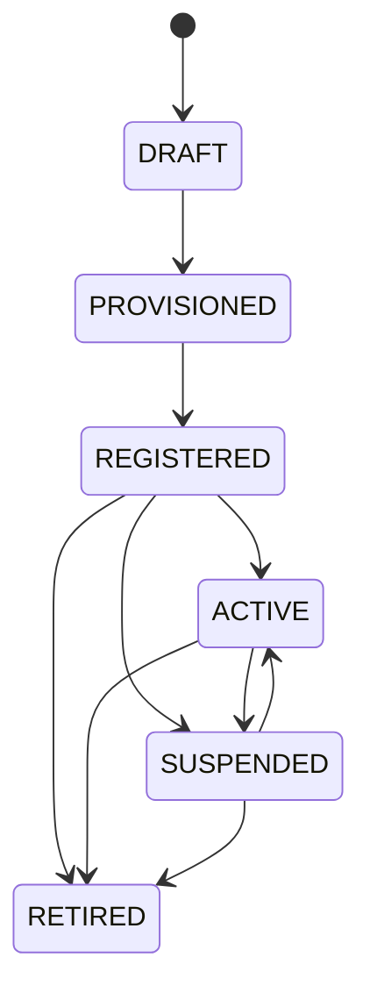

# Agent Lifecycle Protocol v0.4-draft

Status: proposed application protocol. Date: 2026-10-21.

This document defines eight normative modules and provider binding requirements. The BNB Smart Chain profile is specified in [the companion BAP](../../BAP-728.md). The protocol is chain-neutral; a binding fixes deployment-specific addresses, dependency revisions, proof formats, finality, and trust assumptions. No external foundation endorsement or deployed reference implementation is implied.

## 1. Conventions and architecture

MUST, MUST NOT, SHOULD, SHOULD NOT, and MAY have the meanings in RFC 2119 and RFC 8174. Module versions for this draft are CORE 0.4, DISC 0.4, A2A 0.4, RT 0.4, VERIFY 0.4, COMM 0.1, CONF 0.4, and SCHEMA 0.4. A deployment MUST pin an immutable revision or digest for each implemented module and dependency. An absent profile is unsupported, not implicitly conforming.

An owner authorizes policy and appoints a lifecycle controller. A registrar binds a dedicated wallet to an identity. A runtime executes agent reasoning; an isolated signer enforces policy. Providers sell resources; facilitators settle payments. A commerce service accepts work without holding the owner's or agent's keys. These roles MAY share infrastructure but MUST retain the authorization boundaries below. All operations affecting funds or state MUST be authenticated, replay protected, and durably journaled.

Unless a field explicitly specifies another algorithm, digests are SHA-256 over raw artifact bytes or RFC 8785 canonical JSON bytes for structured records, encoded as 0x-prefixed lowercase hex. A digest field does not itself prove authorship. Decimal-string uint256 values MUST be range checked against 2^256 - 1 after parsing. Origin fields MUST contain only scheme and authority, without paths, queries, fragments, or user information; remote endpoint URLs MUST reject user information and follow the binding's SSRF restrictions.

A binding MUST specify its request/response encoding, error taxonomy, authentication, authority checks, operation lookup, finality rule, and version negotiation. No implementation MAY infer authorization from natural-language instructions, an unsigned descriptor, TLS alone, or possession of a task identifier.

## 2. ALP-CORE: lifecycle and economic authority

### 2.1 States and valid transitions

| State | Meaning |
| --- | --- |
| DRAFT | Local agent configuration exists; no delegated spending authority. |
| PROVISIONED | Dedicated wallet exists and the owner has explicitly approved policy. |
| REGISTERED | Finalized identity, verified wallet binding, and discoverable service descriptor exist. |
| ACTIVE | One runtime has current spend authority and a real self-funding cycle has succeeded. |
| SUSPENDED | New work and ordinary autonomous spending are disabled; identity persists. |
| RETIRED | Terminal identity state; authority revoked and obligations assigned for resolution. |



REGISTERED-to-SUSPENDED and REGISTERED-to-RETIRED explicitly support abandonment or revocation before first activation. DRAFT or PROVISIONED configurations MAY be locally abandoned after cleaning up any side effects; this is not on-chain retirement. If registration was partially completed, the existing identity MUST be reconciled and retired through the registered-state recovery path before abandonment is declared complete.

A transition MUST use an operation identifier, expected current sequence, target state, evidence commitment, policy digest, and authority epoch. The controller MUST serialize competing transitions through compare-and-set. A failed attempt has an outcome in the journal; FAILED is not a lifecycle state. Partial execution MUST NOT authorize downstream behavior or be reported as a successful transition.

### 2.2 Transition preconditions

- **DRAFT to PROVISIONED:** Create a wallet dedicated to this agent. Inventory all spend paths. Obtain explicit owner approval of every policy field. Store keys in a signer-accessible secrets facility; model code MUST NOT access them. No spend authority is issued before approval.
- **PROVISIONED to REGISTERED:** Register or reconcile one identity; verify current ownership and dedicated-wallet control; publish the descriptor and required interfaces; commit a finalized lifecycle record. An advertised Commerce profile requires its pinned task contract. A Core-only agent MUST explicitly advertise that Commerce is unsupported.
- **REGISTERED to ACTIVE:** Deploy the verified artifact; confirm endpoint ownership and readiness; install one current authority epoch; perform and reconcile one actual payment on the declared self-funding rail, including provider credit; then commit ACTIVE. Payment during activation is permitted only under an owner-approved, bounded activation capability. New tasks remain disabled until activation commits.
- **ACTIVE to SUSPENDED:** Atomically stop new task acceptance and new ordinary signing. Trigger on owner instruction, policy breach, low balance, unverifiable identity, loss of authority lease, or failed reconciliation. The controller MUST record the cause. Safety shutdown takes effect even if recording the chain transition is unavailable; discovery MUST report unavailable rather than continuing to advertise verified ACTIVE.
- **SUSPENDED to ACTIVE:** Revalidate owner, wallet, policy, resources, artifact, endpoint, and outstanding authorizations. Obtain fresh owner approval after a policy or ownership change. Install a unique current authority epoch and prove funding readiness. Prior completed activation evidence MAY be reused only if its binding remains unchanged and live credit is verified; otherwise repeat the funding cycle.
- **Any permitted state to RETIRED:** Stop intake and ordinary signing; finalize the permanent retirement record; revoke all spend paths; invalidate or wait out outstanding authorizations; transfer unresolved commitments to their precommitted settlement path; destroy runtime secrets after revocation and required handover evidence is durable. Until all required steps complete, report retirement as pending and keep operational gates closed.

Suspension and retirement do not cancel escrow terms. Restricted settlement capabilities MAY survive solely for existing obligations if separately owner-approved, bounded by job, asset, amount, expiry, and callable method, and incapable of accepting new tasks or refilling resources. Fully permissionless escrow refunds require no agent key. Destruction of a signing key MUST NOT strand obligations that require it; arrange delegated settlement before destruction.

### 2.3 Partial failures and journal

The journal MUST distinguish `pending`, `succeeded`, `failed`, and `reconciling`. It MUST record external transaction identifiers before retrying an uncertain operation. The same operation identifier and identical request MUST resolve to one logical result; reusing it with different contents MUST fail with `IDEMPOTENCY_CONFLICT`. Irreversible effects MUST be reconciled forward, not hidden by restoring a local snapshot.

| Partial failure | Required behavior |
| --- | --- |
| Identity created, wallet binding fails | Remain PROVISIONED, disable activation, record the identity, retry binding against that identity. |
| Wallet binding succeeds, descriptor publication fails | Keep spending and intake disabled; repair publication before REGISTERED. |
| Registry checkpoint fails after publication | Treat public descriptor as pending, not registered; reconcile chain state before retry. |
| Deployment succeeds, readiness or payment fails | Remain REGISTERED; disable ordinary authority; reconcile payment before retry. |
| Payment settles, provider credit is unknown | Hold reservation and reconcile with provider; do not automatically purchase again. |
| ACTIVE checkpoint succeeds but response is lost | Read committed state by identity and sequence; do not issue another authority lease. |
| Process crashes mid-task | Persist job ownership and committed terms; resume idempotently or follow timeout settlement. |
| Retirement checkpoint succeeds, revocation is pending | Registry stays terminal; advertise retirement cleanup pending and never restart work. |

Before every signature and new task acceptance, the gate MUST verify the current state, policy version, owner/wallet binding, and authority epoch using the binding's freshness rule. Failure to verify MUST deny the operation. Suspension SHOULD remain possible during a control-plane outage through a local stop gate.

### 2.4 Owner policy and accounting

The owner MUST approve a policy containing, for each asset and resource: `balance_threshold`, `refill_amount`, `daily_spend_cap`, `balance_floor`, and `provider_allowlist`. A provider entry MUST bind a service origin, settlement beneficiary, asset, chain, permitted contract/methods, maximum charge, and quote expiry. Additional assets require separate caps unless an owner-approved valuation rule provides a conservative shared cap. Floating point arithmetic MUST NOT be used for amounts.

`daily_spend_cap` is a rolling 86,400-second ceiling, not a calendar-day reset. At time t, accepted new liability MUST satisfy:

```
settled_outflows_in_(t-86400,t] + all_unresolved_reserved_liability + new_liability <= daily_spend_cap
```

A reservation MUST be created atomically before releasing any signature or spending capability. Reservations cover fees and the maximum executable amount, including allowances and batch subcalls. They MUST remain until final settlement, proven on-chain cancellation, or verified expiry under the payment scheme. A settled liability replaces its reservation atomically; it MUST NOT be counted twice. An expired accounting window does not release an executable authorization. Refunds MUST NOT reduce gross outflows within the window and create fresh allowance to spend again. The signer MUST reject both overspend and cap-avoidance through concurrency, retries, alternative rails, or runtime migration.

A rejected attempt to exceed a hard cap MUST trigger suspension. Clock rollback or loss of a trusted accounting clock MUST deny signatures until reconciled. Each refill MUST leave the owner-approved asset floor intact; insufficient funds MUST suspend autonomous operation. Provider credit units and token units MUST be explicit and distinct.

### 2.5 Self-funding cycle

1. Read authenticated resource balances and asset balances. Reject stale or ambiguous units.
2. When resources fall below their threshold, obtain a bounded quote. Verify the x402 challenge against policy; challenges are untrusted input.
3. Reserve maximum liability and issue one narrowly scoped authorization through the signer. Payment and business-operation identifiers MUST be durably linked before submission.
4. Obtain settlement evidence satisfying the chain binding. A facilitator response alone is insufficient when it cannot establish the declared finality rule.
5. Verify the provider credited the intended resource account. Persist a receipt joining operation, settlement, provider account, credit quantity, and policy version. Resume monitoring.

A lost response MUST be looked up by operation identifier before retry. Providers without idempotent purchase lookup or equivalent reconciliable receipts MUST NOT be used for autonomous refills. HTTP retries MUST NOT create a fresh authorization while the prior one can still execute. An agent MAY pay a relay fee within policy; gasless means the agent need not hold native gas, not that settlement has no economic cost.

### 2.6 Authority inventory and revocation

The inventory MUST include raw-key signing services, ERC-20 allowances, operator approvals, EIP-7702 delegations, smart-account modules, session keys, facilitator-held authorizations, recovery credentials, and pending transactions. The owner recovery authority MUST remain outside the reasoning runtime. A binding MUST explain which authorizations can be revoked, which must expire, and how execution after shutdown is prevented or bounded. Already released signatures cannot be recalled by deleting a secret.

## 3. ALP-DISC: discovery and handshake

An agent MUST serve a descriptor at `/.well-known/alp.json` over HTTPS. It MUST include the fields in SCHEMA A.1. L0 is the pinned chain identity and lifecycle record; L1 is the registry-linked registration document; L2 is the live descriptor and session handshake; L3 is third-party directories. Directories MUST be treated as hints and MUST NOT override L0 or authenticate an endpoint by themselves.

The descriptor's unsigned claims MUST be checked against L0 and a fresh wallet proof. The descriptor digest is SHA-256 of its RFC 8785 canonical JSON, without a proof field; no secrets appear in it. Clients MUST reject unknown mandatory modules, incompatible pinned revisions, chain mismatch, stale lifecycle sequences, or RETIRED identities. Cached ACTIVE status MUST NOT substitute for live authorization.

The descriptor MUST publish a `handshake_endpoint`. A client sends its intended audience (the exact HTTPS origin), a cryptographically random 32-byte nonce encoded as lowercase hex, and the expected descriptor digest. The server returns the A.2 payload with expiry at most 300 seconds after issuance and a proof by the current bound agent wallet. The binding MUST fix the typed-signature domain and verifier; EVM bindings MUST use EIP-712 with chain ID and lifecycle registry as verifying contract, or ERC-1271 verification against the current wallet. A nonce is consumed once per audience; the verifier MUST reject expiry, replay, changed descriptor, identity mismatch, stale epoch, or changed ownership. Authentication grants no spending authority.

The EVM signed type is `ALPHandshake(string agentRegistry,string agentId,string audience,bytes32 nonce,bytes32 descriptorDigest,uint256 lifecycleSequence,uint256 authorityEpoch,uint256 issuedAt,uint256 expiresAt)`. Its domain is name `Agent Lifecycle Protocol`, version `0.4`, the chain ID, and lifecycle registry address. `descriptorDigest` and `nonce` are decoded from their hex transport representation into bytes32. Timestamps are Unix seconds. A.2's transport `proof` is excluded from the signed fields. Callers MUST verify the domain and every field, not just recover a signer.

## 4. ALP-A2A: communication profile

An implementation claiming this module MUST serve a valid Agent Card for the exact A2A release declared in its binding. ALP metadata MUST use that release's extension mechanism, with extension URI `urn:alp:extensions:lifecycle:0.4`. Within that extension's parameters, `alp.identity` identifies the canonical registry tuple, lifecycle registry, and descriptor URL; `alp.payment` lists supported rails, networks, assets, and commerce endpoints. These are proposed ALP extension identifiers, not a claim of upstream registration.

Clients MUST perform ALP-DISC verification before relying on economic claims. An A2A task identifier MUST map durably to an ALP operation identifier and, if applicable, a chain-qualified escrow job identifier. Transport cancellation does not refund an escrow. A2A task completion is not settlement finality. MCP access follows its declared protocol and authorization model; exposing a signing tool to the model MUST NOT bypass ALP-CORE policy checks.

## 5. ALP-RT: runtime abstraction and migration

A runtime binding MUST define authenticated operations `deploy`, `inspect`, `suspend`, `resume`, `export`, `import`, and `destroy`, each with operation identifiers and lookup semantics. It MUST describe resource isolation, key custody, logs, secrets, checkpoint encryption, and availability assumptions. Exported application state MUST exclude raw wallet keys and owner recovery material.

Portable Runtime conformance requires six migration phases:

1. **Prepare:** Pin target artifact and bindings, verify capability compatibility, and establish a migration operation identifier. The target has neither intake nor spend authority.
2. **Quiesce:** Stop source intake; checkpoint tasks, outstanding authorizations, reservations, policies, and resource receipts. Mark the agent SUSPENDED before handover.
3. **Fence:** Revoke the source lease and increment the authority epoch in a shared, strongly consistent authority service. All signer and task-ingress paths MUST enforce this epoch; an isolated source MUST fail closed. Released authorizations MUST be reconciled, cancelled, or allowed to expire before authority passes to the target.
4. **Transfer:** Encrypt state to the target, verify its digest and sequence, and obtain an authenticated import receipt. Secret access is re-established through the wallet binding, not copied through model memory.
5. **Activate:** Verify source fencing, target readiness, unchanged identity/wallet/policy, and accounting continuity. Grant the target the sole current lease, perform resume checks, and commit ACTIVE before opening intake.
6. **Finalize:** Destroy source runtime credentials and transient exports, collect a destruction receipt, and commit the migration result. Retain only authorized audit evidence.

A lease MUST bind runtime ID, authority epoch, expiry, identity, and policy digest. Gate checks MUST be synchronous with authorization or rely on short-lived capabilities whose non-overlap is provable. A process-local mutex or best-effort shutdown does not fence an unreachable source. A new epoch cannot invalidate an already signed token transfer: the migration MUST separately handle those signatures. Rollback before fencing MAY restore the source; after fencing, either runtime requires a newly issued sole lease. Never restore an old epoch from backup. If the authority service cannot prove exclusive authority, remain SUSPENDED.

## 6. ALP-VERIFY: artifact verification

A verifier MUST consume immutable artifact bytes, dependency lockfiles, configuration inputs, a versioned rule pack, and declared binding capabilities. It MUST return a deterministic verdict, artifact digest, rule-pack digest, finding identifiers, and evidence locations. Same inputs MUST yield the same verdict; external databases or time-dependent rules MUST be snapshotted as explicit inputs. A verdict MUST NOT be a language-model assessment.

Rules MUST check for embedded signing secrets, model access to raw keys, bypassable spending enforcement, unbounded allowances, undeclared payees or contract methods, unsafe secret export, and deployment configuration escaping the isolation model. Unresolved dynamic destinations MUST be denied or proven constrained by the signer. An arbitrary toolchain SHOULD run this gate; a Certified Toolchain MUST refuse deployment on a failing or indeterminate verdict. Verification MUST be repeated when artifact, rule pack, or security-relevant binding configuration changes. Passing is evidence about these rules, not proof of benign behavior or freedom from vulnerabilities.

## 7. ALP-COMM: commerce and adjudication

### 7.1 Jobs and commitments

The selected ERC-8183 revision remains authoritative for underlying job states and caller permissions. A binding MUST expose its exact ABI; ALP does not invent an interchangeable ABI for different ERC revisions. Every job MUST be identified by network, contract, and job ID, and linked to the ALP provider identity.

Before funding, buyer and provider MUST commit to asset, budget, fees, deliverable schema/hash or acceptance criteria, evaluator adapter, dispute mechanism, evidence limits, and absolute deadlines. Terms MUST be hashed and durably retrievable; changing them requires a new agreement and MUST NOT modify funded obligations. The evaluator adapter MUST prevent mismatched terms, asset substitution, and charges beyond the committed amount. Fee-on-transfer and rebasing tokens MUST be rejected unless the binding explicitly preserves escrow accounting for them.

### 7.2 Adapter state and upstream mapping

| ALP adapter phase | Underlying ERC-8183 state | Permitted result |
| --- | --- | --- |
| CREATED | Open | Agree terms and fund, or cancel the agreement. |
| FUNDED | Funded | Submit work, reject under committed terms, or expire. |
| DELIVERED | Submitted | Evaluate, dispute, complete, reject, or expire. |
| DISPUTED | Submitted | Resolve through the committed arbiter before expiry. |
| SETTLED | Completed | Terminal provider payment. |
| CANCELLED | Rejected or Expired; or Open with irrevocably closed adapter agreement | Terminal refund or unfunded agreement cancellation. |

DISPUTED is not an ERC-8183 job state. Unfunded cancellation MUST prevent subsequent funding of that adapter agreement even if the underlying Open job remains present. Adapter phase and underlying terminal state MUST be reconciled before any action. A terminal job MUST never release funds twice.

Each agreement MUST set `funding_deadline < delivery_deadline < evaluation_deadline <= expiredAt`. A dispute MUST resolve or use its precommitted default before `expiredAt`; no adapter can extend the underlying job's expiry. Boundary checks use chain time with `now >= deadline` for timeout. At or after a deadline, the adapter MUST deny competing late actions. Anyone MUST be able to trigger the corresponding default. Funding expiry cancels the unfunded agreement; delivery expiry rejects/refunds the funded job through the evaluator adapter; evaluation expiry applies the committed complete-or-refund default to a submitted job. At `expiredAt`, the binding MUST allow permissionless native refund and MUST prevent evaluator actions from racing to change that default. This last requirement may require an evaluator wrapper even when the upstream contract alone allows different behavior. Native refund MUST remain available if the adapter fails.

### 7.3 Evaluation order and arbiter interface

Committed deterministic checks MUST run first in a bounded environment: digest equality, schema validation, or a pinned test suite. Only criteria the committed checks cannot decide MAY be referred to subjective adjudication. The selection, incentives, fees, appeal rules, and fallback of that adjudicator MUST be part of the original terms. Neither party nor the evaluator MAY replace it unilaterally after funding.

The following proposed interface is ALP-specific and does not claim to be an accepted companion ERC:

```solidity
interface IALPArbiter {
    function requestRuling(
        bytes32 disputeId,
        bytes32 termsHash,
        bytes32 evidenceHash,
        uint64 rulingDeadline
    ) external;

    function ruling(bytes32 disputeId) external view returns (
        bool finalised,
        uint8 outcome,
        bytes32 rationaleHash
    );
}
```

`disputeId` MUST be `keccak256(abi.encode(block.chainid, commerceContract, jobId, adapterAddress))`. Outcome 0 means undecided, 1 means pay provider, and 2 means refund client; other values MUST be rejected. The adapter MUST authenticate the committed arbiter and exact dispute/terms/evidence tuple. Request retries MUST be idempotent; changed request contents MUST revert. The arbiter MUST authenticate the agreement's adapter and MUST NOT allow a third party to preempt a dispute identifier. A final ruling MUST be immutable. A finalised outcome MUST be 1 or 2 and include a nonzero rationale commitment. The adapter records the rationale before calling the underlying evaluator action. Late rulings are ignored; timeout resolution remains permissionless. No subjective ruling may override an already terminal job or spend beyond escrow.

## 8. ALP-CONF: conformance claims

| Profile | Required modules and evidence |
| --- | --- |
| Core Agent | CORE, DISC, SCHEMA, CONF; identity/wallet proof, lifecycle and funding evidence. |
| A2A Agent | Core Agent plus A2A; valid card and authenticated economic extension. |
| Portable Runtime | Core Agent plus RT; demonstrated fenced migration and accounting continuity. |
| Commerce Agent | Core Agent plus COMM; escrow adapter, deterministic checks, timeout and arbiter tests. |
| Certified Toolchain | CORE, DISC, SCHEMA, CONF, VERIFY; enforced deployment gate and reproducible results. |

Claims MUST name module versions, dependency/binding digests, implementation digest, test-suite revision, results, date, and tested network. Claims MUST distinguish self-attestation from independent assessment and identify the assessor if any. The profile name Certified Toolchain is a conformance label in this draft, not an externally awarded certification. No implementation can claim conformance based only on this document, a schema-valid descriptor, or a successful payment. Failure in a mandatory test invalidates the corresponding claim until corrected and rerun. See [the conformance matrix](conformance.md).

## 9. ALP-SCHEMA: normative records A.1-A.8

[schemas.json](schemas.json) uses JSON Schema draft 2020-12. A schema validates shape; implementations MUST additionally enforce the cross-record authorization, accounting, signature, finality, and state rules above. Unknown fields are rejected in this draft's core records; forward extensions require a negotiated schema revision. Amounts and uint256 identifiers are decimal strings without leading zeros; times are nonnegative Unix-second integers, hashes are lowercase 0x-prefixed 32-byte hex. Network IDs use CAIP-2 form. Public records MUST NOT contain keys or credentials.

| Record | Required meaning |
| --- | --- |
| A.1 Descriptor | Identity, lifecycle state/sequence, current epoch, policy digest, profiles, endpoints, and binding digests. |
| A.2 Handshake | Fresh challenge, audience, descriptor digest, identity coordinates, sequence, epoch, timestamps, and wallet proof. |
| A.3 Policy | Explicitly approved per-asset limits and allowed providers; owner approval evidence. |
| A.4 Transition | Expected source and target, sequence, epoch, operation identifier, and evidence commitment. |
| A.5 Payment receipt | Operation/authorization link, exact asset and beneficiary, settlement checkpoint, credited account and resource units. |
| A.6 Migration | Source/target, phase, monotonically increasing epoch, checkpoint digest, and outstanding-liability digest. |
| A.7 Verification | Artifact/rule-pack/input digests, deterministic verdict, and finding IDs. |
| A.8 Commerce terms | Chain-qualified job, provider identity, asset, budget/fees, evaluator/arbiter, criteria commitment, and deadlines. |

A.3's `owner_approval` is a binding-defined owner signature or authenticated approval receipt over the canonical policy excluding that field. An implementation MUST pin that format and prove both owner identity and exact contents. It MUST NOT treat an arbitrary string in that field as approval. Schema A.4 describes committed chain-visible transitions starting from PROVISIONED; local DRAFT-to-PROVISIONED provisioning MUST instead journal the owner approval and wallet creation evidence before an identity exists.

## 10. Binding publication and evolution

Bindings SHOULD be independently maintained under chain, payment-rail, runtime, wallet, and arbiter namespaces. Each MUST identify its author, immutable revision, supported modules, prerequisites, compatibility limits, and security assumptions. Vendors acquire no special authority by supplying a binding. Changes to lifecycle edges, signed payloads, schemas, spending semantics, or settlement rules require an incompatible version and explicit migration; they MUST NOT be silently applied to a live agreement. A binding claiming v0.4 conformance MUST NOT weaken a MUST requirement.

## 11. License

The content is licensed under [CC0](https://creativecommons.org/publicdomain/zero/1.0/).
