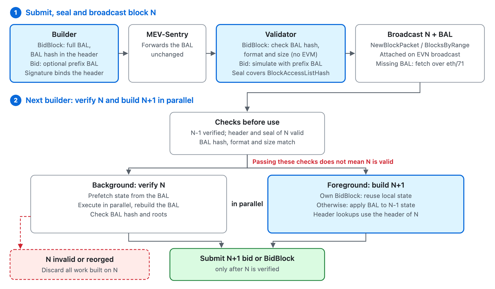

```
  BEP: 732
  Title: Block Access Lists for MEV Block Production
  Status: Draft
  Type: Standards
  Created: 2026-10-28
  Description: Carry the Block Access List on the SendBid and SendBidBlock paths so that blocks are verified in parallel and builders can build the next block before the parent is imported.
```

# BEP-732: Block Access Lists for MEV Block Production

- [BEP-732: Block Access Lists for MEV Block Production](#bep-732-block-access-lists-for-mev-block-production)
  - [1. Summary](#1-summary)
  - [2. Abstract](#2-abstract)
  - [3. Motivation](#3-motivation)
  - [4. Specification](#4-specification)
    - [4.1 Builder](#41-builder)
    - [4.2 MEV-Sentry](#42-mev-sentry)
    - [4.3 Validator](#43-validator)
    - [4.4 gRPC Transport](#44-grpc-transport)
  - [5. Backward Compatibility](#5-backward-compatibility)
  - [6. Security](#6-security)
  - [7. Performance Analysis](#7-performance-analysis)
  - [8. License](#8-license)

## 1. Summary

On BSC, most blocks are produced from builder submissions on two paths: a Bid (`SendBid`), which the validator simulates before sealing, and a BidBlock (`SendBidBlock`, [BEP-675](./BEP-675.md)), which the validator seals without simulation. On both paths the builder must import the parent block before building the next one, and on the Bid path the validator also simulates the bid. Each of these is a full EVM pass that grows linearly with the gas limit.

This BEP introduces a Block Access List (BAL, [EIP-7928](https://eips.ethereum.org/EIPS/eip-7928)) on both paths. The party that executes the block produces it — the builder for a BidBlock, the validator for a Bid — and the validator binds it to the sealed block and propagates it. The BAL lets every node prefetch the state of a block and verify it in parallel, lets the validator simulate a bid in parallel, and lets builders build the next block from the parent's BAL instead of waiting for the parent to be imported.

## 2. Abstract

The critical path within a single block interval is:

- **Bid:** Import parent block → Builder constructs bid → Validator simulates bid → Block produced
- **BidBlock:** Import parent block → Builder constructs BidBlock → Block produced

A BAL records every account and storage slot a block touches and the value of every change after each transaction. With the BAL of a block, a node can execute its transactions in parallel and prefetch their state, and a builder can derive the post-state of the block without executing it. This BEP produces the BAL on both paths and has the validator bind it to the sealed block and propagate it:

- **Bid:** Apply parent BAL → Builder constructs bid (parent verified in parallel) → Validator simulates bid in parallel → Block produced
- **BidBlock:** Apply parent BAL → Builder constructs BidBlock (parent verified in parallel) → Block produced

## 3. Motivation

BEP-675 raised the practical gas limit by removing validator-side simulation, but only for BidBlocks. The Bid path coexists permanently and serves builders without BidBlock permission, so its critical path still contains the validator's simulation. On both paths, the critical path also contains parent import, whose cost scales linearly with the gas limit and which the builder cannot shorten. Parent import limits validators as well: a validator producing consecutive blocks accepts submissions for the next block only after importing its own previous block, and every sealed block is re-executed after broadcast, which risks a verification backlog at higher gas limits.

A BAL removes parent import from the builder's critical path and turns block verification and bid simulation into parallel execution. This BEP specifies how the BAL is produced, bound and propagated on both paths, so that the time previously spent waiting for execution is available for building, making room for a substantially higher gas limit.

## 4. Specification

This BEP activates with the BSC hard fork that adopts EIP-7928. From that fork, every block header carries `BlockAccessListHash = keccak256(rlp(BAL))`, and the BAL encoding, validation rules, size constraint and block access index assignment follow EIP-7928 as adopted by BSC, including the indices of Parlia system transactions.



### 4.1 Builder

The builder constructs and submits a BidBlock as specified in BEP-675, with the following changes:

1. **Record the BAL** — while executing user transactions and the unsigned system transactions, record the BAL as EIP-7928 specifies. Transactions and bundles that the builder tries and then drops are removed together with their BAL entries. Signing does not affect EVM state changes, and the BAL contains no transaction hashes, so the BAL recorded with unsigned system transactions remains valid after the validator signs them.
2. **Commit the BAL** — set `BlockAccessListHash` in the header to `keccak256(rlp(BAL))`.
3. **Submit the BAL** — attach the BAL to `BidBlockArgs`, or to the gRPC request ([Section 4.4](#44-grpc-transport)).

**`BidBlockArgs` data structure:**

```go
type BidBlockArgs struct {
    BidBlock        *BidBlock
    BlockAccessList hexutil.Bytes // EIP-7928 RLP-encoded BAL
    Signature       hexutil.Bytes
}
```

- **`Signature`** — unchanged: the builder signs `keccak256(rlp(header))` of the header it submits. The header carries `BlockAccessListHash`, so the BAL is bound to the BidBlock without a separate signature.
- **`BlockAccessList`** — required for every BidBlock from the activation fork.

**Building on an unimported parent.** When the BAL of block `N` arrives with the block, the builder may start building `N+1` before `N` is imported. If `N` is its own BidBlock, it reuses the post-state of its own execution after confirming that `N` matches it by `ParentHash`, `StateRoot` and the execution results; `TxHash` and the block hash are not used for matching, because the validator signs system transactions and rewrites `Extra`. Otherwise, it applies the final post-values of the BAL of `N` to the state of `N-1`, once the header and seal of `N` and its BAL have passed the checks of [Section 4.3](#43-validator). Building `N+1` also reads the header of `N`: for example, `BLOCKHASH(N-1)` is the `ParentHash` of `N`, and the Parlia validator set is derived from the headers up to `N`. Since `N` is not yet imported, the builder takes this information from the received header of `N`; otherwise the execution of `N+1` would be wrong. The builder then:

- verifies `N` by full execution while building `N+1`, prefetching the state declared by the BAL of `N` and executing its transactions in parallel, and **does not submit** a bid or BidBlock with parent `N` until this verification succeeds;
- cancels all work derived from `N` if verification fails, the derived state root does not match `header.Root`, or `N` is reorganised out;
- keeps the derived state isolated: it is not committed, not published as the chain head, and not used to advance the transaction pool, and the transactions of `N` are excluded from `N+1` by the builder itself.

**SendBid.** On the legacy path, the builder submits candidate transactions and a bid as today, and may attach a **prefix BAL**:

- it covers block access index 0 and the bid transactions in submission order, recorded on the same parent and header context the validator will simulate with; it does not cover transactions the validator merges, `PayBidTx` or system transactions;
- the BAL of the final block is produced by the validator ([Section 4.3](#43-validator)). Because the validator adds transactions, a builder cannot reuse its own execution state for a block built from its bid, and builds on such a block through its BAL.

**`RawBid` and `BidArgs` data structures:**

```go
type RawBid struct {
    // ... existing fields, unchanged
    BlockAccessListHash *common.Hash `json:"blockAccessListHash" rlp:"optional"` // keccak256 of the prefix BAL
}

type BidArgs struct {
    RawBid          *RawBid
    BlockAccessList hexutil.Bytes `json:"blockAccessList"` // EIP-7928 RLP-encoded prefix BAL
    Signature       hexutil.Bytes `json:"signature"`
    // ... PayBidTx fields added by MEV-Sentry, unchanged
}
```

- **`Signature`** — unchanged: the builder signs `keccak256(rlp(RawBid))`. When a prefix BAL is attached, `RawBid` carries its hash, so the signature binds the prefix BAL.
- **Not provided** — `BlockAccessListHash` is absent and `BlockAccessList` is empty. The RLP encoding of `RawBid`, and therefore the signature, is identical to that of a bid without this BEP.
- **Provided** — both fields are set and `keccak256(BlockAccessList)` equals `BlockAccessListHash`. A prefix BAL with no entries is the RLP empty list (`0xc0`) and counts as provided. A bid with only one of the two fields set, or with a hash mismatch, is rejected.

### 4.2 MEV-Sentry

MEV-Sentry forwards the BAL with the BidBlock without additional processing. On the gRPC path it forwards the BAL as raw bytes, like the BidBlock RLP, without re-encoding. On the `SendBid` path it forwards the prefix BAL unchanged and attaches `PayBidTx` as today.

### 4.3 Validator

The validator processes BidBlocks and bids in the following stages and selects the best one as specified in BEP-675. Where the two paths differ, each stage describes both.

**1. Pre-seal verification**

*BidBlock.* In addition to the BEP-675 header verification, the validator verifies, without EVM execution:

- the BAL is present and its size is within the EIP-7928 size constraint;
- `keccak256(BlockAccessList)` equals `BlockAccessListHash` in the header;
- the BAL is canonically encoded and satisfies the EIP-7928 ordering and index rules.

These checks establish that the BAL is the one committed by the builder-signed header and is within resource bounds; they do not establish that it is correct. Any failure causes immediate rejection. Once a BidBlock passes, the validator may start a bounded prefetch of the state the BAL declares.

*SendBid.* The validator simulates the bid and produces the complete BAL of the final block. The final block contains, in order, the block-begin protocol operations (block access index 0), the `k` bid transactions, the transactions merged from the validator's mempool, `PayBidTx` and the system transactions; each transaction takes the block access index of its position in the transaction list. The validator:

- checks the prefix BAL, if provided: its hash matches `BlockAccessListHash` in the signed `RawBid`, its size and format are valid, and its indices do not exceed `k`;
- prefetches the state the prefix BAL declares and executes index 0 and the bid transactions in parallel; before executing anything else, it compares the BAL rebuilt for indices `0..k` with the prefix BAL, and a mismatch fails the bid. Without a prefix BAL, these transactions are executed sequentially;
- continuing from the resulting state, executes the merged transactions, `PayBidTx` and the system transactions sequentially, recording their entries at their own indices. The complete BAL consists of these entries and those for indices `0..k`.

**2. Finalize, assemble and seal**

As on each path today, with one change to the seal: from the activation fork, the header fields signed by the Parlia seal include `BlockAccessListHash`. The sealed BAL therefore cannot be replaced without invalidating the seal.

- *BidBlock* — the BAL is used as submitted: signing the system transactions does not change any state access, so the BAL and `BlockAccessListHash` stay unchanged.
- *SendBid* — the validator sets `BlockAccessListHash = keccak256(rlp(BAL))` of the complete BAL in the header it assembles.

**3. Broadcast**

The BAL is pushed with the block, and fetched on demand only when it is missing:

- **Validator to EVN and proxied peers** — the validator sends the BAL together with the sealed block. Validators and builders receive new blocks through the direct broadcast of the Enhanced Validator Network ([BEP-563](./BEP-563.md)), so they get the BAL at the same time as the block.
- **Relaying nodes** — a node that receives a block with its BAL keeps the BAL and forwards it with the block, including when serving the block to peers that fetch it.
- **Missing BAL** — a node that receives a block without a BAL, or needs the BAL of an earlier block for synchronisation, fetches it over eth/71 ([EIP-8159](https://eips.ethereum.org/EIPS/eip-8159)).

The BAL is an optional field of `NewBlockPacket` and of each block in a `BlocksByRange` response, omitted when no BAL is attached. Support for this field is negotiated when peers connect, separately from eth/71, and the BAL is sent only to peers that support it.

**4. Asynchronous import**

After broadcasting a BidBlock, the validator imports the block as in BEP-675, using the BAL to prefetch the state it declares, continuing any prefetch started before sealing, and to execute the block in parallel:

- execute the block and rebuild the BAL from the actual execution;
- verify the rebuilt BAL against `BlockAccessListHash`;
- verify the state root, receipts root, logs bloom and gas used.

Any mismatch fails the import and triggers the BEP-675 permission revocation.

### 4.4 gRPC Transport

gRPC carries only `SendBidBlock`; `SendBid` and the other MEV APIs remain on JSON-RPC, where the prefix BAL travels with the bid. Only `BidBlockRequest` therefore changes: the BAL is a separate `bytes` field, carrying its EIP-7928 RLP encoding unchanged:

```proto
message BidBlockRequest {
  bytes bid_block_rlp = 1;
  bytes signature = 2;
  string validator_host_name = 3;
  // EIP-7928 RLP-encoded BAL, bound by BlockAccessListHash in the header.
  bytes block_access_list = 4;
  reserved 5 to 10;
}
```

- **Not inside `bid_block_rlp`** — MEV-Sentry decodes `bid_block_rlp` to verify the builder signature; a separate field lets it forward the BAL without decoding it.
- **Not a structured protobuf message** — the commitment is the `keccak256` of the RLP encoding, so the validator hashes the received bytes directly, before decoding them.
- **Message size** — the gRPC message limit of MEV-Sentry and the validator, currently twice the maximum block size, accounts for the BAL in addition to the BidBlock.

## 5. Backward Compatibility

This BEP requires a hard fork: it activates with the BSC adoption of EIP-7928 and changes the header encoding signed by the Parlia seal from that fork. Blocks before the fork are unaffected.

The `SendBid` and `SendBidBlock` paths continue to coexist as specified in BEP-675. The `BidBlockArgs` field, the gRPC field and the block message fields are additive, and nodes negotiate support for the block message field during the bsc protocol handshake.

## 6. Security

Each node accepts a block only if its own execution rebuilds the BAL committed in the header and passes the existing checks; with a missing or unusable BAL, the node executes the block sequentially.

- **Replacing the BAL** — before sealing, the BAL is bound by the builder-signed header; after sealing, by the Parlia seal. A replaced BAL fails the hash check and is discarded before execution.
- **Incorrect BAL** — a BAL that matches the header but not the execution makes the block invalid. The validator detects it during asynchronous import and revokes the builder as in BEP-675. The worst case remains one bad BidBlock per builder per revoke window.
- **Withholding** — a BidBlock without a BAL is rejected before sealing.
- **Building on an invalid parent** — a builder submits a bid or BidBlock only after verifying its parent, and a validator accepts submissions only for parents it has imported.
- **Resource use** — the BAL is size-bounded by EIP-7928 and checked with one hash before use, and pre-seal prefetching is bounded and does not delay sealing.
- **Early exposure** — the BAL leaves the validator only after sealing, together with the block that reveals the same state changes.

## 7. Performance Analysis

Using the model of BEP-675, let `G` denote the gas limit in Mgas and `R` the EVM throughput; one pass over `G` takes `G/R` time. Let `s` denote the speedup of parallel execution against a BAL, and `t_apply` the time to check the BAL and derive the parent post-state from it.

- **BEP-675** — 2 EVM passes on the critical path (parent import + builder execution):
  `2·(G/R) + overhead = block_interval`
- **This BEP** — the builder starts after `t_apply`, and parent verification `G/(s·R)` runs in parallel with building:
  `max(t_apply + G/R, G/(s·R)) + overhead = block_interval`

When parallel verification finishes within the building time, the critical path contains a single EVM pass, and solving for `G` yields up to roughly twice the BEP-675 gas-limit ceiling, reduced by `t_apply` and by contention between verification and building. Equivalently, the interval during which builders execute and pack transactions is no longer shared with parent import. The BAL also shortens the asynchronous verification of every sealed block by the factor `s`, and adds to the BidBlock payload, which favors the binary gRPC transport.

## 8. License

This document is licensed under [CC0](https://creativecommons.org/publicdomain/zero/1.0/).
