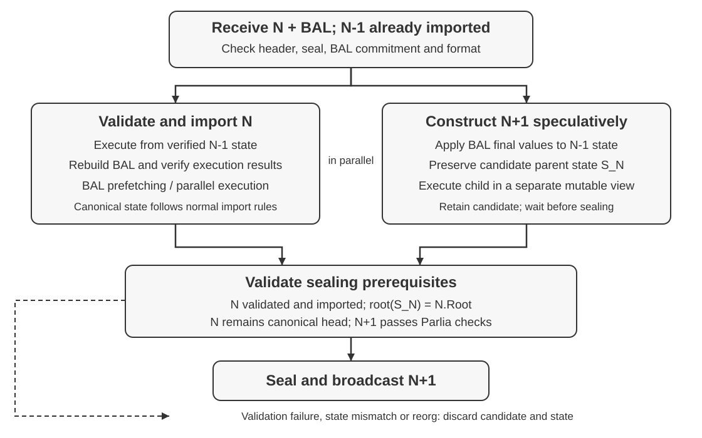
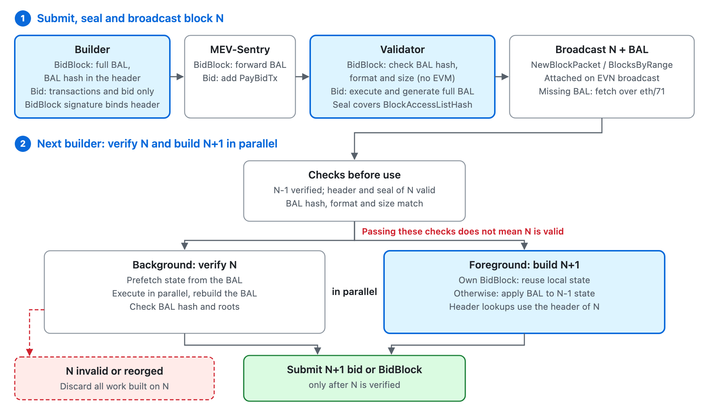
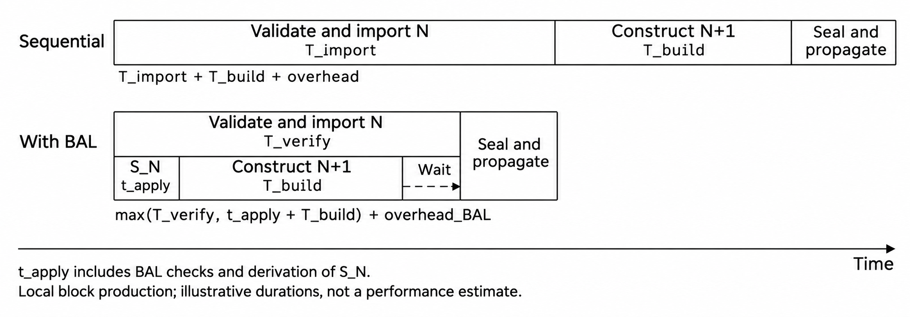

```
  BEP: 732
  Title: Enable Parallel Block Production with Block Access Lists
  Status: Draft
  Type: Standards
  Created: 2026-10-28
  Description: Adopt Block Access Lists on BSC to overlap parent validation with local block construction, with supporting MEV and propagation extensions.
```

# BEP-732: Enable Parallel Block Production with Block Access Lists

- [BEP-732: Enable Parallel Block Production with Block Access Lists](#bep-732-enable-parallel-block-production-with-block-access-lists)
  - [1. Summary](#1-summary)
  - [2. Abstract](#2-abstract)
  - [3. Motivation](#3-motivation)
  - [4. Specification](#4-specification)
    - [4.1 Concurrent Block Import and Local Mining](#41-concurrent-block-import-and-local-mining)
      - [4.1.1 Parent State and Concurrent Execution](#411-parent-state-and-concurrent-execution)
      - [4.1.2 System Transactions and BAL Recording](#412-system-transactions-and-bal-recording)
      - [4.1.3 Finalization and Sealing](#413-finalization-and-sealing)
    - [4.2 MEV Path Protocol Extensions](#42-mev-path-protocol-extensions)
      - [Validator Processing of BidBlocks](#validator-processing-of-bidblocks)
    - [4.3 Block and BAL Propagation](#43-block-and-bal-propagation)
  - [5. Backward Compatibility](#5-backward-compatibility)
  - [6. Security](#6-security)
  - [7. Performance Analysis](#7-performance-analysis)
  - [8. License](#8-license)

## 1. Summary

BSC supports three block-production paths: local mining by the validator, a Bid (`SendBid`) that the validator simulates and completes, and a BidBlock (`SendBidBlock`, [BEP-675](./BEP-675.md)) that the validator seals without simulation.

This BEP adopts Block Access Lists (BALs, [EIP-7928](https://eips.ethereum.org/EIPS/eip-7928)) with BSC-specific execution boundaries and signature binding. Its primary application is to overlap validation of block N with local construction of N+1; builders may use the same mechanism on the MEV paths. BALs also support state prefetching and parallel transaction verification. The party executing the block generates its BAL, and the validator seals and propagates the block with the BAL on all three production paths.

## 2. Abstract

This BEP specifies the BSC adoption of Block Access Lists (BALs) and their use for concurrent parent validation and local block construction. A validator derives the parent's candidate post-state from its BAL and begins local block construction while parent validation proceeds independently. The proposal defines state isolation, validation requirements and failure handling, together with supporting BidBlock and BAL propagation extensions. Builders may adopt the same construction mechanism.

## 3. Motivation

As the gas limit increases, importing a received parent consumes more of the time available for transaction packing. When the parent has not yet been fully validated and no reusable execution result is available, local block construction must wait for parent execution to complete. The two operations form a sequential critical path even though the parent's BAL can already describe the state needed to start construction.

Overlapping these operations expands the building window without changing the block interval. BAL-driven prefetching and parallel verification can further reduce import latency, but the scheduling improvement also applies when parent verification uses sequential execution. It benefits local block production directly. When builders adopt the same approach, it can significantly expand the construction window for Bid and BidBlock, allowing builders to include more transactions and increasing overall system throughput.

## 4. Specification

From activation, BSC adopts [EIP-7928 (revision d4c5755)](https://github.com/ethereum/EIPs/blob/d4c575521d99ec881a444ab3af604e684b5f0743/EIPS/eip-7928.md), subject to the execution boundaries below, without changing BSC state-transition rules or introducing Ethereum-specific system operations or Engine API changes.

### 4.1 Concurrent Block Import and Local Mining

Let `N` be a block whose parent `N-1` has already been imported. When validation of `N` is pending and no matching local execution result is available, the validator may construct `N+1` concurrently with importing `N`. This applies at validator turn handover and when an external BidBlock's BEP-675 verification remains pending, even without a validator change.

The flow below describes local mining; the BAL recording and Parlia seal rules also apply to the MEV paths.

<p align="center">
  
</p>

#### 4.1.1 Parent State and Concurrent Execution

The validator checks `N`'s header and Parlia seal, and the BAL's encoding, ordering, indices, size and hash commitment. Applying the BAL's final values to the verified state of `N-1` yields a candidate post-state `S_N`. A matching commitment does not establish execution correctness.

The validator may construct and execute candidate block `N+1` against an isolated state view initialized from `S_N`, concurrently with full validation of `N`. `S_N` itself is kept unchanged so that its root can be compared with the verified post-state of `N`. The candidate uses `N` as its parent and derives its header and Parlia consensus context from that branch, including the validator snapshot, turn assignment, recent signers and timestamp rules. Ancestor-header lookups and `BLOCKHASH` must resolve on the same branch. Candidate execution does not advance the canonical head or modify the state used to validate `N`.

Validation of `N` independently executes its transactions and protocol operations, reconstructs the BAL, and verifies its commitment, state root, receipts and existing validity conditions. BAL-driven parallel prefetching of accounts, code and storage can overlap execution; parallel transaction execution can further shorten validation. Parallel construction does not require `N` to be validated with parallel transaction execution.

#### 4.1.2 System Transactions and BAL Recording

Parent-state queries and candidate-block execution require separate state views. At epoch boundaries, Parlia reads the validator set and turn length from the parent state; at breathe blocks, validator election reads StakeHub election information and the maximum elected-validator count from that state. These queries must support the candidate post-state `S_N` before `N` is imported, using `N`'s header as their execution context. Query execution must preserve `S_N` and must not read the evolving state of `N+1`.

System transactions for `N+1`, including applicable reward distribution, slashing and validator-set updates, execute against the candidate block's mutable state. The complete BAL for `N+1` must include their state accesses and changes, as well as direct protocol balance updates and system-contract code changes at the applicable upgrade boundaries. State changes retain their prescribed execution order, and transaction packing preserves the existing gas reservation for system transactions.

**BSC execution boundaries.** Parlia system transactions use their one-based positions in the final transaction list as BAL indices, like user transactions. Let `n` be the total transaction count, including system transactions; block-begin operations use index `0`, and block-end operations use `n+1`.

Direct state changes in `Finalize`, including the balance transfer from `SystemAddress` to coinbase before `deposit` and system-contract upgrades, are recorded together with the next system transaction included in the block, or at `n+1` if none follows. Production and verification MUST preserve the existing execution order and record the combined net state changes at that index. Fee accumulation during user execution remains at each user transaction's index.

Direct protocol reads outside transaction execution and protocol system calls MUST NOT by themselves add addresses or storage reads to the BAL. This exclusion does not apply to protocol state changes or accesses during transaction execution or protocol system calls.

Accesses and state changes attributable solely to system transaction attempts omitted from the final block MUST NOT contribute to the BAL; preceding protocol operations remain subject to the index rules above. All other recording rules follow the referenced EIP-7928 revision.

#### 4.1.3 Finalization and Sealing

The validator completes the candidate's system transactions and protocol processing through `FinalizeAndAssemble`, deriving the final state root, transaction root, receipt root and BAL commitment. Before sealing `N+1`, it must complete validation and import of `N`, confirm that the state root of `S_N` equals the successfully validated `N.Root`, and verify that the candidate satisfies Parlia's validator eligibility, recent-signing and timestamp rules. `N` must remain the canonical head at sealing.

If parent validation fails, the derived state does not match, or `N` is no longer the canonical head, the dependent candidate and its state are discarded. Otherwise, the candidate's execution result may be reused while its parent and execution context remain valid. After sealing, local production uses the executed state and receipts for normal block insertion and propagates the block with its BAL under Section 4.3. If neither a usable BAL nor a matching local execution state is available, construction waits for parent execution.

**Parlia seal encoding.** Blocks before activation retain the existing encoding. After activation, `BlockAccessListHash` is a required 32-byte value and MUST be encoded immediately after `RequestsHash` in the Parlia seal-signing RLP. All other field encodings, their order, and the exclusion of the final 65-byte seal from `Extra` remain unchanged.

After activation, double-sign evidence verification (`0x68`) MUST use the extended Parlia signing encoding for headers containing `BlockAccessListHash` and the legacy encoding otherwise, preserving compatibility with pre-fork evidence. Normal block-header validation MUST reject the field before activation and require it after activation.

### 4.2 MEV Path Protocol Extensions

The `SendBidBlock` path carries the complete BAL from builder to validator. On the `SendBid` path, the request format is unchanged and the validator produces the complete BAL. The shared BAL recording and Parlia seal rules in Sections 4.1.2 and 4.1.3 also apply.

Builders may apply the same mechanism when constructing bids or BidBlocks, and submit only after the parent has been verified locally. The receiving validator accepts a submission only after importing its parent and while that parent is its current canonical head.

**BAL field and signature binding.** Add the RLP-encoded BAL as a byte field inside `BidBlock`:

```go
type BidBlock struct {
    Header          *types.Header     `json:"header"`
    Transactions    []hexutil.Bytes    `json:"transactions"`
    Sidecars        types.BlobSidecars `json:"sidecars,omitempty"`
    BlockAccessList hexutil.Bytes      `json:"blockAccessList,omitempty" rlp:"optional"`
}
```

The builder supplies the complete BAL, including execution of unsigned system transactions, and sets `BlockAccessListHash = keccak256(BlockAccessList)` in the submitted header. The builder signs the submitted header hash, `BidBlock.Header.Hash()`, which binds the BAL through `BlockAccessListHash`. `BidBlockArgs` retains its existing `BidBlock` and `Signature` fields.

`BlockAccessList` is required from the activation fork. It contains the canonical EIP-7928 RLP bytes; an empty BAL is encoded as `0xc0`, not an omitted field. In the BidBlock RLP envelope, it is a trailing byte string after `Sidecars`. This does not add the BAL to the canonical block-body RLP.

#### Validator Processing of BidBlocks

**Pre-seal checks.** In addition to BEP-675 checks, the validator verifies BAL presence, size, canonical encoding, ordering and indices, and checks `keccak256(BlockAccessList)` against the submitted header commitment. These checks require no EVM execution. Failure rejects the submission; after they pass, the validator may begin bounded BAL-driven state prefetching.

**Signing and sealing.** The validator signs the system transactions and recomputes `TxHash` as in BEP-675. Signing alone changes neither execution nor the BAL, so the submitted BAL commitment is retained. From activation, the Parlia seal covers `BlockAccessListHash` on all production paths. The sealed block and BAL are then propagated under [Section 4.3](#43-block-and-bal-propagation).

**Asynchronous verification.** After broadcasting a BidBlock, the validator imports it as in BEP-675. BAL-driven prefetching overlaps execution, and BAL-based parallel execution may accelerate verification. Actual execution rebuilds the BAL and checks its commitment, state root, receipts root, logs bloom and gas used. A confirmed invalid BidBlock fails import and triggers BEP-675 permission revocation. Missing or corrupted attachment data alone is not grounds for revocation; the validator can obtain the committed BAL or rebuild it through execution.

The following diagram illustrates the mechanism on the MEV paths:



### 4.3 Block and BAL Propagation

For local mining, SendBid and SendBidBlock, the complete BAL MUST accompany post-fork new-block broadcasts to peers that have negotiated BAL support:

- **Validator to EVN and proxied peers** — the validator sends the BAL together with the sealed block through the Enhanced Validator Network ([BEP-563](./BEP-563.md)).
- **Relaying nodes** — relays MUST retain and forward the BAL with the block. A post-fork new-block broadcast received over a BAL-enabled connection without a BAL MUST be rejected and MUST NOT be relayed. This rejects the incomplete message, not the block hash; the same block may subsequently be received with its BAL.
- **Synchronisation and independent retrieval** — BALs needed for synchronisation or separate retrieval are fetched over eth/71 ([EIP-8159](https://eips.ethereum.org/EIPS/eip-8159)).

BAL attachment support is negotiated when peers connect, separately from eth/71. The attachment is mandatory in post-fork `NewBlockPacket` messages on BAL-enabled connections. It remains optional for each block in a `BlocksByRange` response used for synchronisation; missing BALs can be fetched separately. BAL attachments are sent only to peers that support them.

## 5. Backward Compatibility

This BEP requires a hard fork to activate the BAL rules in Section 4 and the extended Parlia signing encoding. Blocks before the fork are unaffected. Independent Parlia seal verifiers, including light clients and bridges that verify these seals, must adopt the activation-dependent signing encoding.

The `SendBid` request is unchanged. The builder continues to sign the submitted header hash; from activation, that header includes `BlockAccessListHash`. Upgraded BidBlock decoders accept the pre-fork RLP envelope by treating the trailing `BlockAccessList` field as optional; from activation, a complete BAL is mandatory. Older decoders cannot consume the extended envelope, so builders, MEV-Sentry and validators must upgrade before activation. Nodes negotiate support for BAL attachments in block messages during the bsc protocol handshake.

## 6. Security

Each node accepts a block only if its own execution rebuilds the BAL committed in the header and passes the existing checks. During synchronisation, a node may execute a block sequentially to reconstruct a missing or unusable BAL and verify the commitment. New-block broadcasts remain subject to the attachment requirements in Section 4.3.

- **Replacing the BAL** — on the BidBlock path, the builder signature binds the submitted header, and the validator checks the BAL against its `BlockAccessListHash` commitment. On local mining and Bid paths, the validator generates the BAL locally. After sealing, the BAL on all three paths is bound by the Parlia seal. A replaced BAL fails the hash check and is discarded before execution.
- **Incorrect BAL** — a BAL that matches the header but not the execution makes the block invalid on every path. For a BidBlock, the producing validator detects it during asynchronous import and revokes the builder as in BEP-675. The worst case remains one bad BidBlock per builder per revoke window; builder permission revocation does not apply to local mining.
- **Withholding** — a BidBlock without a BAL is rejected before sealing.
- **Building on an invalid parent** — a builder submits a bid or BidBlock only after verifying its parent, and a validator accepts submissions and seals locally constructed children only after the parent is imported and is its current canonical head. Candidate state is isolated, and dependent work is cancelled on failed validation or reorganisation.
- **Resource use** — the BAL is size-bounded by EIP-7928 and checked with one hash before use, and pre-seal prefetching is bounded and does not delay sealing.
- **Early exposure** — the BAL leaves the validator only after sealing, together with the block that reveals the same state changes.

## 7. Performance Analysis

The benefits differ across the three production paths:

| Path | Parent-verification overlap | Remaining production work |
| --- | --- | --- |
| Local mining | Pending parent validation overlaps local construction, including at validator handover or after sealing an external BidBlock | Execute the locally selected transactions and finalize the block; locally executed parents with matching results can reuse their state |
| Bid | Builder construction overlaps verification of a received parent | Validator simulation remains sequential and produces the complete BAL |
| BidBlock | Builder construction overlaps verification of a received parent | Validator seals without simulation, then verifies the BidBlock asynchronously |

All three generate BALs that receiving nodes can use for prefetching and parallel verification. These benefits do not imply that transactions in a newly selected candidate can be executed in parallel using only its parent's BAL.

**Local mining with pending parent validation.** Let `T_import` be the time to import the received parent without BAL acceleration, `T_verify` the time to verify and import it with BAL support, and `T_build` the time to execute and finalize the next local candidate. Let `t_apply` be the time to check the BAL and derive the candidate parent state. For the same candidate workload, the relevant completion times are:

- **Before:** `T_import + T_build + overhead`
- **With BAL:** `max(T_verify, t_apply + T_build) + overhead_BAL`

This model applies while parent validation is pending and no matching local execution result is available; validator handover is one such case.



**BidBlock.**

For the BidBlock path, using the model of BEP-675, let `G` denote the gas limit in Mgas and `R` the EVM throughput; one pass over `G` takes `G/R` time. Let `s` denote the speedup of parallel execution against a BAL, and `t_apply` the time to check the BAL and derive the parent post-state from it.

- **BEP-675** — 2 EVM passes on the critical path (parent import + builder execution):
  `2·(G/R) + overhead = block_interval`
- **This BEP** — the builder starts after `t_apply`, and parent verification `G/(s·R)` runs in parallel with building:
  `max(t_apply + G/R, G/(s·R)) + overhead = block_interval`

This model assumes that the receiving validator has imported `N` and still has `N` as its canonical head when the submission arrives. Otherwise, validator readiness adds waiting time; builder-side overlap cannot remove this constraint. The theoretical gas-limit ceiling can approach twice that of BEP-675 only when both builder parent verification and validator parent import complete within the construction and delivery window, with gains limited by `t_apply` and resource contention. BAL parallel execution also reduces BidBlock asynchronous verification time to `1/s` of the baseline.

## 8. License

This document is licensed under [CC0](https://creativecommons.org/publicdomain/zero/1.0/).
